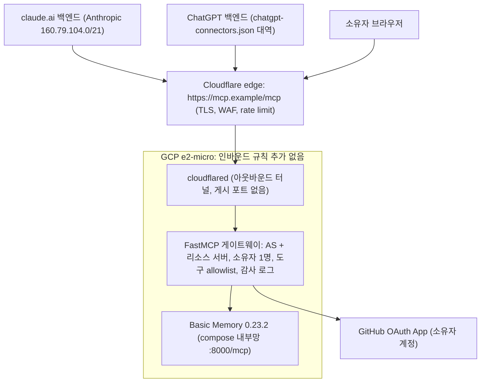

# claude.ai와 ChatGPT 웹에서 자체 호스팅 Basic Memory를 쓰려면 무엇을 열어야 하나

- 기준: 2026-10-16 시점의 스냅샷이다. 이후 바뀐 사실은 반영하지 않는다. 저장소 안 사실과 줄 번호는 `main` 9a43084 기준이다. 그 뒤 이름이 바뀐 문서는 지금 이름으로 적었다.
- 표기: 출처 링크가 붙은 문장은 `Verified`(그날 1차 출처에서 확인)다. "Unverified"는 검색 발췌, 제3자 자료, 직접 열지 못한 문서에서 온 내용(`Reported`에 해당)이고, "(추정)"은 `Assumption`이다.
- 방법: 네 주제(Claude 웹 커넥터, ChatGPT 웹 커넥터, MCP 인증 방식, 노출 경로의 비용과 보안)를 서브에이전트 넷이 나눠 공식 문서, 벤더 도움말, GitHub 소스와 릴리스, 저장소 로컬 파일로 조사했다. 웹 검색과 조회는 Exa를 썼다. 이 조사와 2026-10-22 시제품 측정을 근거로 [웹 커넥터 설계](../specs/spec-2026-10-22-tn23wwmd-web-connector.md)를 썼고, 소유자 결정은 그 설계의 §1에 있다(이 조사의 추천과 다른 항목이 있다).

두 웹 클라이언트는 벤더 클라우드에서 MCP 서버를 부르므로, tailnet이나 `127.0.0.1` 터널이 아니라 공개 IPv4 HTTPS 호스트명과 OAuth 2.1 인가 서버가 필요하다. Basic Memory 0.23.2에는 인증이 없어서, 권장 구성은 Cloudflare named Tunnel(인바운드 방화벽 규칙 추가 0개) 뒤에 GitHub 로그인 한 명만 통과시키는 FastMCP OAuth 게이트웨이를 두는 것이고, 추가 고정비는 도메인 하나다. 가장 큰 위험은 네트워크 노출보다 간접 프롬프트 인젝션이 쓰기·삭제 도구를 움직이는 것이며, ChatGPT는 플랜에 따라 쓰기 도구가 막혀 Claude를 먼저 붙이는 순서가 맞다.

## 1. 두 웹 클라이언트는 공개 IPv4 HTTPS와 OAuth 2.1을 요구한다

용어부터 정리한다. **MCP(Model Context Protocol)**는 LLM 앱이 외부 도구 서버를 호출하는 표준 프로토콜이다. Basic Memory는 그중 **streamable HTTP** 전송을 쓴다. 한 URL(`/mcp`)에 JSON-RPC 요청을 POST하고, 필요하면 스트리밍으로 응답을 받는 방식이다. 사용자가 URL을 직접 넣어 등록하는 원격 MCP 서버를 Claude는 "custom connector", ChatGPT는 "custom MCP server"(Plugins 화면의 앱)라고 부른다. 이번 문제의 핵심 제약은 **호출하는 주체가 누구인가**다. Claude 도움말은 "Connections to remote MCP servers originate from Anthropic's cloud infrastructure, not from your device"라고 적고, 사설망이나 VPN 뒤의 서버는 연결되지 않는다고 못 박는다([Claude Help 11175166](https://support.claude.com/en/articles/11175166-about-custom-connectors-using-remote-mcp)). ChatGPT도 로컬 MCP 서버 연결에 대해 "Not directly. ChatGPT connects to remote MCP servers"라고 답한다([OpenAI Help 12584461](https://help.openai.com/en/articles/12584461-creating-custom-mcp-apps-in-chatgpt)). Claude는 호스트명이 사설 대역, **CGNAT `100.64.0.0/10`**, loopback, link-local로 풀리면 요청을 보내기 전에 거절한다. 커넥터가 **IPv4 전용**이어서 AAAA 레코드만 있는 호스트명도 실패한다([Claude troubleshooting](https://www.claude.com/docs/connectors/building/troubleshooting)). 이 규칙을 그대로 적용하면, 현재 두 접근 모드의 tailnet 이름과 `make tunnel`의 `127.0.0.1:18737`은 어느 쪽도 웹 클라이언트에서 쓸 수 없다.

인증 방식도 사실상 하나로 좁혀진다. Claude는 `none`(인증 없음)과 OAuth(`oauth_dcr`, `oauth_cimd`)를 기본으로 지원한다. API 키나 bearer 토큰을 넣는 `static_headers`는 "Beta, for a limited set of organizations"이고, 조직 Owner가 입력하는 기능이다([Claude docs: Authentication](https://www.claude.com/docs/connectors/building/authentication)). 개인 Pro/Max 계정에 이 beta가 열리는지는 문서에 없다. ChatGPT의 선택지는 OAuth, No authentication, 둘의 혼합뿐이다. ChatGPT는 "cannot present custom API keys or customer-provided mTLS certificates"이고, client credentials 같은 machine-to-machine grant도 지원하지 않는다([OpenAI Plugins Authentication](https://developers.openai.com/plugins/build/auth)). "No sign-in"은 URL을 아는 누구나 쓸 수 있다는 뜻이다. 두 벤더의 송신 IP 대역은 모든 사용자가 공유하므로, IP 제한을 붙여도 다른 Claude/ChatGPT 사용자를 막지 못한다(3절). 쓰기 도구가 있는 무인증 서버에 이 선택지는 받아들일 수 없다. 남는 공통분모는 **OAuth**다.

OAuth 용어를 짧게 정의한다. **OAuth 2.1**은 사용자가 비밀번호를 넘기지 않고, 클라이언트(여기서는 Claude/ChatGPT 백엔드)에 접근 토큰을 위임하는 표준이다. 로그인을 받고 토큰을 발급하는 쪽이 **인가 서버(AS)**이고, 토큰을 검사하고 API를 제공하는 쪽이 **리소스 서버**다. MCP에서는 MCP 서버가 리소스 서버다. **PKCE S256**은 클라이언트가 만든 일회용 비밀의 해시를 authorize 때 보내고 원문을 token 교환 때 보내서, 가로챈 code를 쓸모없게 만드는 장치다. **RFC 9728 Protected Resource Metadata(PRM)**는 MCP 서버가 "내 토큰은 이 AS에서 받으라"고 알리는 `/.well-known/oauth-protected-resource` 문서다. 토큰 없는 요청에 `401`과 `WWW-Authenticate: Bearer resource_metadata="..."`로 그 위치를 알려 준다. **RFC 8414**는 AS가 자기 엔드포인트를 알리는 메타데이터 문서다. 클라이언트 등록 방식은 두 가지다. **DCR(RFC 7591)**은 클라이언트가 AS의 `/register`에 자신을 즉석 등록하는 방식이다. **CIMD(Client ID Metadata Document)**는 클라이언트 ID 자체가 클라이언트 메타데이터 문서의 URL(예: `https://chatgpt.com/oauth/client.json`)이어서 사전 등록이 필요 없는 방식이다. **RFC 8707 `resource`**는 토큰을 특정 서버용(audience)으로 묶는 파라미터다. 현재 MCP 스펙 개정판은 **2026-07-28**이다. 이 개정판에서 CIMD는 SHOULD이고, DCR은 "deprecated and retained for backwards compatibility"인 MAY다. 서버는 PRM을 MUST로 제공하고 토큰의 audience를 검증해야 하며, "MCP servers MUST NOT accept or transit any other tokens"를 지켜야 한다([MCP spec 2026-07-28 Authorization](https://modelcontextprotocol.io/specification/2026-07-28/basic/authorization)). Claude가 따른다고 밝힌 인가 스펙은 2025-03-26, 2025-06-18, 2025-11-25다([Claude docs: building](https://www.claude.com/docs/connectors/building/index)). 그래서 **CIMD와 DCR을 둘 다 제공하는 AS**가 두 클라이언트와 가장 넓게 호환된다.

| 요건 | Claude 웹 (claude.ai) | ChatGPT 웹 (chatgpt.com) |
|---|---|---|
| 플랜 | Free(커스텀 커넥터 1개), Pro, Max, Team, Enterprise. Pro/Max는 본인이 Customize > Connectors에서 추가 ([Help](https://support.claude.com/en/articles/11175166-about-custom-connectors-using-remote-mcp)) | 쓰기 포함 Full MCP는 Business/Enterprise/Edu beta. Pro는 read/fetch만. Free/Go는 불가. Plus는 문서끼리 충돌 ([Help 12584461](https://help.openai.com/en/articles/12584461-creating-custom-mcp-apps-in-chatgpt)) |
| 전송 | Streamable HTTP (HTTP+SSE는 deprecated) | SSE, streaming HTTP. 공개 HTTPS `/mcp` 또는 Secure MCP Tunnel ([Developers](https://developers.openai.com/api/docs/guides/custom-mcp-server)) |
| URL | HTTPS, 공개 IPv4 A 레코드. 교차 호스트 리다이렉트는 `Authorization`을 떨어뜨림. 443 외 포트는 문서에 없음 | 공개 HTTPS. 443 외 포트와 자체 서명 인증서 허용 여부는 문서에 없음 |
| 인증 | `none`, OAuth(DCR/CIMD) 기본. `static_headers`는 제한 beta | OAuth, No auth, 혼합. API 키·M2M 미지원 |
| PKCE | S256 항상 전송, 메타데이터에 S256 광고 필요 | S256 필수, 미광고 시 "unsupported" ([Apps SDK Auth](https://developers.openai.com/apps-sdk/build/auth)) |
| 클라이언트 등록 | CIMD는 `client_id_metadata_document_supported: true`와 `token_endpoint_auth_methods_supported`의 `"none"`이 있을 때만 사용, 아니면 DCR(연결마다 새 클라이언트) | CIMD 우선, DCR 대체, 사전 등록 클라이언트도 가능 |
| 콜백 URI | `https://claude.ai/api/mcp/auth_callback` | RFC 9207 `iss` 지원 시 `https://chatgpt.com/connector_platform_oauth_redirect`, 아니면 `https://chatgpt.com/connector/oauth/{callback_id}` |
| 시간 제한 | discovery/registration/token 10초, refresh 30초. 도구 결과 약 150,000자, 호출당 240초 | 직접 연결 한도는 문서에 없음. 터널 경유 시 10 MiB, 120초, 600 req/min ([Secure MCP Tunnel](https://developers.openai.com/api/docs/guides/secure-mcp-tunnels)) |
| 송신 IP | `160.79.104.0/21` 고정, "will not change without notice" ([IP addresses](https://platform.claude.com/docs/en/api/ip-addresses)) | `chatgpt-connectors.json`, IPv4 283개 prefix(creationTime 2026-10-06), "best effort" ([IP egress ranges](https://developers.openai.com/api/docs/guides/ip-addresses)) |
| refresh | 만료 5분 전 선제 갱신, public client는 refresh token 회전 | `offline_access` 없으면 만료 후 재인증 필요 |

도구 동작은 두 클라이언트가 크게 다르다. Claude는 읽기·쓰기·삭제 도구를 모두 허용하고, 호출마다 승인을 묻는다. 도구별로 "Blocked"를 설정할 수 있다. 하지만 **Research 모드에서는 "Claude can invoke connector tools without further approval"**이라서, Anthropic도 쓰기 도구를 꺼 두라고 권한다([Claude Help 11175166](https://support.claude.com/en/articles/11175166-about-custom-connectors-using-remote-mcp)). ChatGPT는 `readOnlyHint` 어노테이션이 없는 도구를 모두 쓰기로 간주한다. 쓰기는 기본적으로 확인을 받고, 승인은 대화 단위로만 기억한다([Add custom MCP server](https://developers.openai.com/api/docs/guides/custom-mcp-server)). "especially risky actions"는 승인 없이 아예 막힐 수 있다. Deep research는 read/fetch만 쓰고, agent mode는 custom 앱을 쓰지 않으며, 모바일에서는 쓸 수 없다([Help 12584461](https://help.openai.com/en/articles/12584461-creating-custom-mcp-apps-in-chatgpt)). Basic Memory 코드에는 `readOnlyHint`가 21곳에 있으므로([GitHub code search](https://github.com/search?q=repo%3Abasicmachines-co%2Fbasic-memory+readOnlyHint&type=code)), 읽기 도구는 ChatGPT에서도 읽기로 분류될 것이다(추정, 실제 `tools/list` 응답으로 확인 필요). ChatGPT 플랜 문제는 기술이 아니라 계약 문제다. 도움말은 "Pro users can connect custom MCP servers with read/fetch permissions"라고 적었다. 그런데 지금은 404가 나는 개발자 문서의 캐시본은 Plus와 Pro에도 읽기·쓰기를 허용한다고 적었고, 제3자 기사도 "OpenAI has not reconciled them explicitly"라고 지적했다([Coworker AI, 2026-07-16](https://coworker.ai/blog/chatgpt-mcp), Unverified 발췌). 2026-10에는 Business Owner가 새 custom MCP 앱을 만들다 `plugins_access_denied`를 받았다는 커뮤니티 보고도 있다([OpenAI Community](https://community.openai.com/t/custom-mcp-app-creation-fails-with-http-500-detail-request-timeout-before-any-request-reaches-mcp-server-both-secure-mcp-tunnel-and-public-https/1402909), Unverified 발췌). 따라서 ChatGPT 쪽은 소유자 계정에서 Plugins → Add custom MCP server를 직접 시도해 보기 전에는 무엇이 될지 확정할 수 없다.

## 2. Basic Memory 0.23.2에는 인증 스위치가 없어 앞단 게이트웨이가 유일한 통제다

Basic Memory는 이 요건을 스스로 채우지 못한다. 최신 릴리스 v0.23.2(2026-08-25)의 `basic-memory mcp` 옵션은 `--transport`, `--host`, `--port`, `--path`, `--project`뿐이고, 인증 플래그가 없다([mcp.py@v0.23.2](https://github.com/basicmachines-co/basic-memory/blob/v0.23.2/src/basic_memory/cli/commands/mcp.py)). 서버는 `auth=` 없이 `FastMCP(...)`로 만들어진다([server.py@v0.23.2](https://github.com/basicmachines-co/basic-memory/blob/v0.23.2/src/basic_memory/mcp/server.py)). 고정된 `fastmcp==4.0.0b1`은 FastMCP 2.x와 달리 환경변수로 인증을 끼워 넣는 설정이 없다([FastMCP settings.py@v4.1.0](https://github.com/PrefectHQ/fastmcp/blob/v4.1.0/fastmcp_slim/fastmcp/settings.py)). 공식 Docker 문서도 "Put authentication, TLS, and network access controls in front of any remote deployment"라고만 안내한다([Basic Memory Docker docs](https://docs.basicmemory.com/raw/reference/docker.md)). 업스트림의 최근 보안 수정(PR #1697, 2026-10-09 병합, 미릴리스)도 인증을 더하지 않았다. 기본 바인딩을 loopback으로 바꾸고 `host_origin_protection="auto"`로 Host/Origin 검사를 켰을 뿐이다([mcp.py@main](https://github.com/basicmachines-co/basic-memory/blob/main/src/basic_memory/cli/commands/mcp.py)). 현재 저장소는 컨테이너 안에서 `--host 0.0.0.0`으로 띄우고(`compose.yaml:10`) 호스트의 `127.0.0.1:8737`에만 게시한다(`compose.yaml:12-13`). 그러니 게이트웨이는 같은 compose 내부망(`compose.yaml:32`의 `basic-memory` 네트워크)으로 붙으면 새 포트를 게시할 필요가 없다. 다음 Basic Memory 릴리스에서 Host 검사가 켜지면 게이트웨이가 보내는 Host 헤더가 거절될 수 있다. 그 경우 `FASTMCP_HTTP_ALLOWED_HOSTS`를 맞추고, `bm-upgrade` 때마다 다시 시험해야 한다(추정).

스펙에 따르면 공개 인터넷에 서는 "MCP 서버"는 Basic Memory가 아니라 게이트웨이다. 게이트웨이가 할 일은 다섯 가지다. 첫째, PRM과 `401 + resource_metadata`를 제공하고, PRM의 `resource`를 등록 URL과 경로까지 정확히 일치시킨다. 둘째, S256과 CIMD(`"none"` 광고 포함), DCR을 제공하는 AS 메타데이터를 낸다. 셋째, 두 벤더의 콜백 URI만 정확히 허용한다. 넷째, 토큰 audience를 검증하고, **클라이언트의 `Authorization` 헤더를 떼어 낸 뒤** Basic Memory로 넘긴다. 다섯째, Basic Memory가 재시작하는 동안에도 OAuth 엔드포인트가 **10초 안에** 응답해야 한다. 이 VM에서 Basic Memory의 콜드 스타트는 healthy까지 약 192초가 걸렸으므로(`docs/plans/plan-2026-10-07-qtvzskgx-vm-rollout.md:284`), 인증 계층은 별도 프로세스여야 한다. 후보를 비교하면 다음과 같다.

| 선택지 | 클라이언트 등록 | 소유자 1명 제한 | 읽기 전용 강제 | 상태 | VM 부담 |
|---|---|---|---|---|---|
| **FastMCP 게이트웨이** (OAuthProxy + GitHubProvider) | CIMD(3.0부터 기본 켜짐) + DCR 에뮬레이션 | `AuthMiddleware` 클레임 검사 몇 줄 | `enable(..., only=True)` allowlist | v4.1.0 (2026-10-08), Apache-2.0 | 두 번째 Python 프로세스 (RSS 미측정) |
| sigbit/mcp-auth-proxy | DCR만 (CIMD 미발견) | `--github-allowed-users` 플래그 | 문서에 없음 | v2.10.2 (2026-05-08) 이후 정체, MIT | Go 바이너리 (작을 것, Unverified) |
| Pomerium Core | CIMD 항상 광고 + DCR 플래그 | 정책 `email: is:` | `mcp_tool` allow/deny, 호출 전부 로그 | v0.33.4 (2026-10-02), Apache-2.0 | Envoy 기반, 가장 무거울 것 (Unverified) |
| Cloudflare Access + Managed OAuth | DCR만 (CIMD 언급 없음) | Access 정책 (email) | 없음 (MCP portal은 도구별 토글) | open beta | `cloudflared`만 |
| workers-oauth-provider (Worker) | CIMD + DCR + 사전 등록, 2026-07-28 준수 | 직접 코딩 | 직접 코딩 | v1.2.3 (2026-10-07), MIT | 터널 커넥터만 |
| oauth2-proxy / Caddy | MCP 미지원 (PR #3488 열림) / 인증 플러그인 없음 | - | - | 현재 불가 | - |
| Basic Memory Cloud | 벤더 OAuth (Claude Directory, ChatGPT 플러그인) | 계정 단위 | - | $15/seat/월, 7일 체험 | 노트가 VM을 떠남 |

출처: FastMCP는 [OAuth Proxy](https://gofastmcp.com/servers/auth/oauth-proxy.md), [Authorization](https://gofastmcp.com/servers/authorization.md), [Visibility](https://gofastmcp.com/servers/visibility.md), [releases](https://github.com/PrefectHQ/fastmcp/releases). sigbit는 [README](https://github.com/sigbit/mcp-auth-proxy). Pomerium은 [MCP 문서](https://www.pomerium.com/docs/capabilities/mcp), [pomerium#6675](https://github.com/pomerium/pomerium/issues/6675). Cloudflare는 [Managed OAuth](https://developers.cloudflare.com/cloudflare-one/access-controls/applications/http-apps/managed-oauth/), [MCP portals](https://developers.cloudflare.com/cloudflare-one/access-controls/ai-controls/mcp-portals/), [workers-oauth-provider](https://github.com/cloudflare/workers-oauth-provider). oauth2-proxy는 [PR #3488](https://github.com/oauth2-proxy/oauth2-proxy/pull/3488). Basic Memory Cloud는 [pricing](https://basicmemory.com/pricing).

**FastMCP 게이트웨이가 1순위**인 이유는 세 가지다. 다섯 요건을 모두 채우고, 저장소에서 가장 활발하게 유지되며, 사용자 제한과 도구 제한을 한 곳에서 강제한다. OAuthProxy는 GitHub처럼 DCR이 없는 업스트림 앞에서 "DCR-style interface"를 흉내 낸다. 클라이언트에게는 업스트림 토큰이 아니라 FastMCP가 서명한 JWT를 발급하므로, GitHub 토큰이 Basic Memory 쪽으로 흘러갈 길이 처음부터 없다([OAuth Proxy](https://gofastmcp.com/servers/auth/oauth-proxy.md)). 함정도 문서에 있다. 프록시는 "By default ... forwards eligible incoming headers, including `Authorization`"하므로 `forward_incoming_headers=False`를 반드시 설정해야 한다. 프록시를 거친 `call_tool()`은 HTTP에서 약 200–500 ms가 걸리고, 도구 목록은 300초 캐시된다([Proxy Provider](https://gofastmcp.com/servers/providers/proxy.md)). 클라이언트 저장소는 영구 볼륨에 두고 `jwt_signing_key`를 명시해야 재시작해도 두 벤더가 다시 등록하지 않는다. 확인되지 않은 것도 넷 있다. v4에서 프록시 서버에 `auth=`를 붙이는 정확한 API, 실제 RSS, Claude가 CIMD를 쓰는 조건인 `"none"` 광고 여부(없으면 DCR로 넘어갈 뿐이다), ChatGPT 콜백 URI를 가르는 RFC 9207 `iss` 지원 여부다. Pomerium은 설정 파일만으로 같은 일을 하고 claude.ai에서 CIMD로 "Chat works"라는 현장 보고까지 있어, 코드를 쓰기 싫다면 가장 강한 대안이다. 다만 Envoy 기반이라 1 GB VM에서는 RAM 측정이 먼저다. 반대로 Cloudflare Access Managed OAuth는 VM 메모리를 거의 쓰지 않지만 넷이 걸린다. 문서가 "The MCP server must validate the Access JWT"를 요구하는데 Basic Memory는 이를 못 하고, DCR만 지원하며, 도구 필터가 없고, claude.ai와 ChatGPT로 시험한 문서도 없다. 또 오리진이 자체 OAuth를 쓰면 Managed OAuth를 켜지 말라는 경고가 있어, 게이트웨이와 겹쳐 쓸 수도 없다([Managed OAuth](https://developers.cloudflare.com/cloudflare-one/access-controls/applications/http-apps/managed-oauth/)). Basic Memory Cloud는 운영 부담이 없는 비교 기준이지만, 자체 호스팅 VM을 지키는 방법이 아니라 대체하는 방법이다([Cloud guide](https://docs.basicmemory.com/raw/cloud/cloud-guide.md)).

## 3. 아웃바운드 터널은 인바운드 0을 지키며 추가 비용은 도메인 하나다

게이트웨이를 공개 HTTPS 호스트명에 올리는 경로는 네 가지다. **Tailscale Funnel**은 모든 플랜에서 무료다. 하지만 443, 8443, 10000 포트에서만 듣고, 방문자 인증을 더하지 않으며, "non-configurable bandwidth limits"가 걸린 beta 기능이다([Tailscale Funnel KB, 2026-01-20 검증본](https://tailscale.com/kb/1223/funnel)). 이 저장소에는 특히 맞지 않는다. tailscale 모드에서는 443과 8443을 Serve가 쓰고 있으므로 Funnel은 10000번이어야 한다. 그런데 두 웹 클라이언트가 443이 아닌 포트를 받는지는 문서에 없다. 같은 포트에서는 "마지막 명령이 이긴다"는 규칙이 있어서, 실수 한 번이면 기존 tailnet 엔드포인트가 공개된다. HTTPS 모드에서는 송신지 IP로 거를 수도 없다. 무엇보다 VM은 사무실 네트워크 차단 때문에 현재 ssh 모드로 돌고 있다(`docs/decisions/adr-2026-10-15-cz8c26gp-access-modes.md:9`). ssh 모드의 `verify`는 VM의 Tailscale이 꺼져 있는지 검사한다(`docs/ARCHITECTURE.md:70`). 그래서 Funnel을 쓰려면 "한 VM에서 두 모드를 함께 쓰지 않는다"는 원칙부터 깨야 하고, Funnel을 막는 검사 세 곳(`tests/repo.bats:191-192`, `scripts/verify-vm.sh:51-54`, `scripts/remote/bootstrap.sh:155-156`)도 풀어야 한다.

**Cloudflare named Tunnel**은 VM의 `cloudflared`가 Cloudflare로 아웃바운드 연결을 열고, Cloudflare edge가 표준 443에서 TLS를 끝내는 방식이다. VM에 인바운드 규칙이 하나도 필요 없다. Zero Trust Free는 "$0 forever", 50명 한도다([Zero Trust plans](https://www.cloudflare.com/plans/zero-trust-services/)). 단 도메인 DNS가 Cloudflare에 있어야 한다. Cloudflare Registrar는 원가에 판매하며([Registrar](https://www.cloudflare.com/products/registrar/)), .com은 연 $10.11–10.46으로 추적된다([StackScored](https://www.stackscored.com/pricing/domain-registrars/cloudflare-registrar/), Unverified 제3자 가격). 도메인이 필요 없는 Quick Tunnel은 테스트 전용이고 "do not support Server-Sent Events (SSE)"라서 streamable HTTP에 쓸 수 없다([Quick Tunnels](https://developers.cloudflare.com/cloudflare-one/networks/connectors/cloudflare-tunnel/do-more-with-tunnels/trycloudflare/)). Free 플랜 WAF는 custom rule 5개와 rate limiting rule 1개(Path 필드, IP 기준, 10초 창)를 준다([WAF rate limiting](https://developers.cloudflare.com/waf/rate-limiting-rules/)). Access 로그는 24시간만 보관한다. 주의할 점도 문서화되어 있다. Claude 문서는 WAF나 봇 규칙이 Anthropic 송신 대역에 403/429를 돌려주는 것을 대표 실패 원인으로 꼽고, 해당 대역의 allowlist를 권한다([Claude troubleshooting](https://www.claude.com/docs/connectors/building/troubleshooting)). ChatGPT에서도 호스팅사 WAF가 DCR 요청을 막아 "registration endpoint returned 466"가 난 사례가 있다([WordPress.org](https://wordpress.org/support/topic/chatgpt-mcp-connector-fails-with-dynamic-client-registration-failed-466/), Unverified 발췌). OpenAI는 스트리밍 응답을 버퍼링하는 프록시가 연결을 깨뜨린다고 경고한다([Apps SDK Troubleshooting](https://developers.openai.com/apps-sdk/deploy/troubleshooting)). named tunnel이 SSE를 버퍼링하는지는 확인하지 못했다. Anthropic도 로컬 서버를 공개 URL로 내보낼 때 Cloudflare Tunnel을 예로 들면서, "A tunnel exposes your local server to the public internet"이니 인증을 켜 두라고 한다([Claude docs: testing](https://www.claude.com/docs/connectors/building/testing)). `cloudflared`의 소규모 RSS는 공식 수치가 없다. "minimum 4GB of RAM"은 8,000명 규모 기준이다([system requirements](https://developers.cloudflare.com/cloudflare-one/connections/connect-networks/configure-tunnels/tunnel-availability/system-requirements/)).

**직접 IPv4 + Caddy**는 지금은 추가 비용이 가장 적어 보인다. VM에 이미 외부 IPv4가 붙어 있기 때문이다(`docs/ARCHITECTURE.md:79`). 정가는 "$0.005 / 1 hour"(월 약 $3.65)이고, 무료 등급은 "one hour per month per account"뿐이다. 그런데 저장소 청구에는 ₩0으로 찍혀 Open question으로 남아 있다([GCP network pricing](https://cloud.google.com/vpc/network-pricing), `docs/ARCHITECTURE.md:80`). 이 경로는 세 가지를 동시에 깬다. 443을 인터넷에 열어 네트워크 수준의 인그레스 0을 깨고, 공인 IP의 443이 거절되어야 한다는 검사(`scripts/verify-vm.sh:18`)를 깨며, 1 GB VM이 인터넷 전역의 스캔을 직접 받는다. 또 **백로그 [ipv6-egress 계획](../plans/plan-2026-10-13-gaewewkf-ipv6-egress.md)(IPv6 전용 전환)과 정면으로 충돌한다**. Anthropic은 IPv4 송신 대역만 공개하고, OpenAI 목록에도 IPv6 prefix가 0개라서, 직접 노출은 유료 IPv4를 계속 붙잡아 두게 된다. GCP 방화벽에서 출처를 `160.79.104.0/21`과 OpenAI 283개 대역으로 좁힐 수는 있다. 하지만 OpenAI는 목록이 "best effort"이고 자주 바뀐다고 하며, 목록에 없는 IP에서 호출이 왔다는 보고도 있다([IP egress ranges](https://developers.openai.com/api/docs/guides/ip-addresses), [Community 1385835](https://community.openai.com/t/bug-unpublished-ip-addresses/1385835) Unverified 발췌). 6월 캐시본에 약 230개였던 prefix가 10월에 283개로 늘어난 것만 봐도 정적 규칙으로는 유지하기 어렵다. **GCP LB + IAP for HTTPS**는 포워딩 규칙만 월 약 $18.25이다([LB pricing](https://cloud.google.com/load-balancing/pricing)). 게다가 Google 신원을 전제로 하므로 벤더 서버가 통과할 수 없다(추정).

| 경로 | 월 고정비 | 일회성 | 인바운드 방화벽 | 경로 자체의 인증 | [ipv6-egress 계획](../plans/plan-2026-10-13-gaewewkf-ipv6-egress.md)(IPv6 전용)과의 관계 |
|---|---|---|---|---|---|
| **Cloudflare named Tunnel** | $0 | 도메인 연 약 $10–11 (Unverified) | 변경 없음 | 없음 (게이트웨이 필요) | 아웃바운드만 필요, IPv6 전용에서 동작 여부 Unverified |
| Tailscale Funnel (10000) | $0 | 없음 | 변경 없음 | 없음 | 아웃바운드만 필요, IPv6 전용에서 동작 여부 Unverified |
| 직접 IPv4 + Caddy | IPv4 약 $3.65 (이미 부담 중, ₩0 Open question) | 없음 | 443 개방 | 없음 | 충돌 (벤더가 IPv4 전용) |
| GCP LB + IAP | 약 $18.25 + $0.008/GiB | 없음 | LB | Google 신원 (부적합) | - |
| 공통 송신 트래픽 | 북미행 월 1 GiB 무료, 이후 Premium $0.12/GiB ([pricing](https://cloud.google.com/vpc/network-pricing)) | | | | |

MCP 트래픽은 호출당 수 KB에서 수십 KB 수준이다. 월 1만 번을 호출해도 1 GiB에 한참 못 미치므로 송신 요금은 사실상 0이다(추정). 선택지 A 밖에 있지만 비교를 위해 벤더 터널 두 가지도 적는다. Claude의 **MCP tunnels**는 Enterprise 플랜에서 요청해야 쓸 수 있는 research preview다. 게다가 "does not authenticate to them"이라서 OAuth는 여전히 필요하다([MCP tunnels](https://www.claude.com/docs/connectors/mcp-tunnels/overview)). OpenAI의 **Secure MCP Tunnel**은 VM의 `tunnel-client`가 `api.openai.com:443`으로 아웃바운드 long-poll을 하는 방식이라 공개 인그레스가 문자 그대로 0으로 유지된다. 준비물은 Platform 조직의 `tunnel_id`와 runtime API key이고, 개인 계정은 personal Platform organization을 쓴다. 다만 Plus/Pro 사용 가능 여부와 과금은 문서에 없다. 또 "The authorization server is not tunneled automatically"라서 OAuth를 붙이면 AS는 따로 공개해야 한다([Secure MCP Tunnel](https://developers.openai.com/api/docs/guides/secure-mcp-tunnels)). ChatGPT만 중요하다면 이 경로는 별도로 평가할 가치가 있다. 무인증 Basic Memory의 접근 경계가 "그 Platform 조직에서 터널을 고를 수 있는 사람"이 되는데, 개인 조직이라면 사실상 소유자 한 명이기 때문이다(추정).

## 4. 진짜 위험은 공개 노출보다 프롬프트 인젝션과 쓰기 도구다

인증을 제대로 붙여도 가장 큰 위험은 남는다. 노트 서버는 Simon Willison이 말한 "lethal trifecta"(개인 데이터 + 신뢰할 수 없는 콘텐츠 + 외부 통신)에서 **개인 데이터** 축을 맡는다. 나머지 두 축은 벤더 채팅이 채운다([simonwillison.net, 2025-06-16](https://simonwillison.net/2025/Jun/16/the-lethal-trifecta/)). 실제 사고도 이 구조였다. 2025-05 GitHub MCP 사건에서는 악성 공개 이슈 하나가 에이전트를 조종해 비공개 저장소 내용을 공개 PR로 흘렸다. 연구자들은 이를 서버 코드 결함이 아니라 "a fundamental architectural issue"로 규정했고, "Always Allow"가 마지막 방어선을 없앴다고 지적했다([Invariant Labs](https://invariantlabs.ai/blog/mcp-github-vulnerability)). Supabase는 "even in read-only mode, prompt injection remains the number one concern"이라고 썼다([Supabase blog](https://supabase.com/blog/defense-in-depth-mcp)). Basic Memory 자체는 "does not execute note content as code"이다([basic-memory SECURITY](https://github.com/basicmachines-co/basic-memory/security)). 하지만 웹에서 클립한 노트 한 장이 모델에게 `delete_note`나 `move_note`를 시키는 시나리오는 막지 못한다.

두 번째 위험은 새로 세우는 정문, 즉 OAuth 설정 실수다. 비교 대상으로 삼을 만한 메모리 MCP 서버 `mcp-memory-service`에서 2026년에 두 건이 나왔다. 하나는 DCR을 기본값으로 열어 둔 탓에 "an unauthenticated attacker can obtain a bearer token with `read write` scope"였던 건이다([GHSA-5p27-64mv-pr73, 2026-08-23](https://github.com/doobidoo/mcp-memory-service/security/advisories/GHSA-5p27-64mv-pr73)). 다른 하나는 엔드포인트 단위로만 scope를 검사해 "A read-only OAuth client can call `store_memory` and `delete_memory`"였던 건이다([CVE-2026-49291](https://github.com/advisories/ghsa-2r68-g678-7qr3)). MCP 보안 모범 사례는 정적 업스트림 client ID, DCR, 동의 쿠키를 섞은 OAuth 프록시가 **confused deputy**(권한 있는 중개자가 공격자의 요청을 대신 실행하는 문제)가 될 수 있다고 경고한다. 그래서 프록시가 클라이언트별 동의를 저장하고, `redirect_uri`를 정확히 일치시키며, 일회용 `state`를 검증해야 한다고 MUST로 요구한다([MCP Security Best Practices](https://modelcontextprotocol.io/specification/2025-11-25/basic/security_best_practices)). 그 밖의 위험은 다음과 같다. 벤더가 들고 있는 refresh token이 유출될 수 있다. FastMCP가 기대는 Python MCP SDK에는 DNS rebinding 보호가 기본으로 꺼져 있던 CVE가 있었다([CVE-2025-66416](https://github.com/advisories?query=CVE-2025-66416)). 1 GB VM은 자원 고갈에 약하다(`docs/plans/plan-2026-10-07-qtvzskgx-vm-rollout.md:283`에서 측정한 available은 394 MB). 마지막은 데이터 거주 문제다. Anthropic 소비자 플랜은 학습 데이터에 커넥터 원문을 넣지 않지만, 대화에 복사된 내용은 예외다([Anthropic Privacy Center](https://privacy.claude.com/en/articles/10023580-is-my-data-used-for-model-training)). OpenAI의 Free/Plus/Go/Pro는 "Improve the model for everyone"이 켜져 있으면 앱에서 읽은 정보를 학습에 쓸 수 있고, 메모리에 남길 수도 있다([OpenAI Connected apps](https://help.openai.com/en/articles/11487775-connected-apps-in-chatgpt)). 업무 노트가 섞여 있다면 이 부분은 기술이 아니라 회사 정책 문제다.

| 위협 | 가능성 × 영향 (추정) | 완화책 | 강제 위치 |
|---|---|---|---|
| 간접 프롬프트 인젝션 → 삭제·덮어쓰기 | 높음 | 처음엔 읽기 도구만 **allowlist**로 연다(denylist 금지). 이후 쓰기는 `write_note`만, 백업 자동화 뒤에. Claude에서 쓰기 도구 Blocked, "Allow always" 금지 | 게이트웨이 (강제), 클라이언트 설정 (보조) |
| 인젝션 → 유출 | 메일·웹 커넥터를 같이 쓰면 높음 | 웹에 보일 노트만 별도 프로젝트로 분리, 업무 노트 제외 | 데이터 범위 |
| 정문 인증 우회 (열린 DCR, 와일드카드 콜백, 사용자 미제한) | 영향 큼 | GitHub `login` = 소유자만, 콜백 URI 정확히 일치(ChatGPT는 관리 화면의 정확한 URI 복사), 동의 화면 유지, scope가 아닌 도구 이름으로 제한 | 게이트웨이 |
| 벤더 측 토큰 유출 | 중간 | 짧은 access token(Cloudflare 권고 5–15분), refresh 회전, 서명 키 회전 = 전체 무효화 | 게이트웨이 |
| 공유 송신 대역 | 중간 | IP 제한은 소음 필터로만 사용. 인증은 필수 | Cloudflare WAF (선택) |
| SDK·프록시 CVE | 중간 | 모든 이미지 digest 고정, `bm-upgrade` 때 게이트웨이도 재검토 | 저장소 규칙 |
| 1 GB 자원 고갈 | 중간 | edge가 스캔을 흡수, rate limit 1개, 컨테이너 메모리 측정 | Cloudflare, compose |
| 데이터 거주·학습 | 소유자 결정 | 업무 노트 제외, ChatGPT 학습 설정 끄기 | 정책 |

감사와 차단 장치도 처음부터 설계해야 한다. Cloudflare Free 로그는 24시간이면 사라지므로, `tools/call`마다 시각, 주체, 도구 이름, 노트 경로를 VM의 영구 디스크에 남긴다. OWASP MCP Top 10의 MCP08도 "detailed logs of tool invocations"를 요구한다([OWASP MCP Top 10](https://owasp.org/www-project-mcp-top-10/)). 차단 장치(kill switch)는 세 겹으로 둔다. 터널 경로를 끄거나 `cloudflared`를 멈추는 네트워크 차단, 게이트웨이 서명 키를 회전해 벤더가 들고 있는 토큰을 모두 무효화하는 토큰 차단, Claude/ChatGPT에서 커넥터를 지우는 클라이언트 차단이다. 저장소의 Make 전용 규칙에 맞춰 이것들을 한 명령으로 묶어야 한다.

## 5. 권장 구성은 Cloudflare Tunnel 뒤 FastMCP 게이트웨이, 읽기 전용부터다

### 구성과 요청 흐름

1. 소유자가 claude.ai(또는 ChatGPT)에 `https://mcp.<도메인>/mcp`를 커스텀 커넥터로 등록하면, 벤더 백엔드가 Cloudflare edge로 요청을 보낸다.
2. edge가 443에서 TLS를 끝내고 WAF와 rate limit을 적용한 뒤, VM이 미리 열어 둔 아웃바운드 터널로 요청을 넘긴다.
3. 게이트웨이는 토큰이 없으면 `401 + resource_metadata`로 응답한다. 벤더는 PRM과 AS 메타데이터를 읽고 CIMD나 DCR로 자신을 등록한다.
4. 소유자 브라우저가 게이트웨이의 authorize 화면을 거쳐 GitHub에 로그인한다. 게이트웨이는 `login`이 소유자인지 확인한 뒤, 벤더 콜백으로 code를 돌려준다.
5. 벤더가 code와 PKCE verifier로 게이트웨이 JWT(audience = 등록 URL)를 받는다.
6. 이후 `tools/call`마다 게이트웨이가 토큰, 사용자, 도구 allowlist를 검사하고 감사 로그를 남긴 뒤, `Authorization`을 떼어 내고 Basic Memory로 전달한다.

게이트웨이와 `cloudflared`는 compose 서비스로 추가한다. 둘 다 포트를 게시하지 않고, 이미지를 digest로 고정하며, 비밀값은 VM `.env`(mode 600)에서만 읽는다. 게이트웨이 이미지는 두 가지 중에서 고를 수 있다. Basic Memory 이미지 안의 `fastmcp==4.0.0b1`을 재사용할 수 있지만 beta 버전이다. 그래서 문서화된 OAuthProxy 기능이 맞는 FastMCP 4.1.x 이미지를 따로 고정하는 편이 Basic Memory 업그레이드와도 분리된다(추정). 도구 allowlist는 `tools/list`로 확인한 실제 이름으로 만든다. `read_note`, `view_note`, `read_content`, 검색, `fetch`, `build_context`, `recent_activity`, `list_directory`가 후보다. 모듈 이름과 노출되는 도구 이름이 다를 수 있으므로 이 목록은 Unverified다([tools dir@v0.23.2](https://github.com/basicmachines-co/basic-memory/tree/v0.23.2/src/basic_memory/mcp/tools)). 공개 호스트명은 공개 DNS와 인증서 투명성 로그에 남는다. 저장소에는 VM IP와 같은 원칙으로 `mcp.<domain>` 같은 자리표시자만 적는다.

### 바뀌어야 하는 저장소 불변식

| 불변식 (AGENTS.md Invariants·Safety) | 현재 강제 위치 | 권장 구성에서의 변화 |
|---|---|---|
| "keep zero public ingress on the VM" | 공인 IP의 22·80·443·8443·8737·3000 거절 검사 (`scripts/verify-vm.sh:18`, `docs/ARCHITECTURE.md:71`) | **재정의 필요.** "인바운드 방화벽 개방 0, 공개 경로는 OAuth 게이트웨이를 거치는 아웃바운드 터널 하나뿐"으로 바꾼다. 포트 거절 검사는 그대로 유효하다 |
| Basic Memory 포트는 `127.0.0.1`에만 게시 | `tests/repo.bats:54` | **유지.** 게이트웨이와 `cloudflared`도 포트를 게시하지 않는다는 테스트를 추가 |
| Tailscale Funnel 금지 | `tests/repo.bats:191-192`, `scripts/verify-vm.sh:51-54`, `scripts/remote/bootstrap.sh:155-156` | **유지.** Funnel 경로를 고를 때만 바뀐다 |
| 한 VM은 한 접근 모드만 (`BM_ACCESS`) | [access-modes ADR](../decisions/adr-2026-10-15-cz8c26gp-access-modes.md), `docs/ARCHITECTURE.md:70` | **보완.** 웹 경로는 에이전트 접근 모드와 직교하는 부가 기능(예: `BM_WEB=on`, 이름은 제안)으로 ADR에 정의 |
| 이미지 digest 고정 | `compose.yaml:7` 패턴 | **확장.** 게이트웨이와 `cloudflared` 이미지에도 적용 |
| 비밀값 두 개 (`TS_AUTHKEY`, `SB_USER`) | AGENTS.md Safety | **세 개 추가.** GitHub OAuth client secret, 게이트웨이 JWT 서명 키, Cloudflare tunnel token. 같은 취급(main checkout `.env`와 VM `.env`만, 명령 인자 금지) |
| 사용자 확인이 필요한 변경 목록 | AGENTS.md Safety | **확장.** Cloudflare DNS·Tunnel·WAF, GitHub OAuth App, 커넥터 등록 추가 |
| 무인증 노출 금지 | Basic Memory SECURITY, AGENTS.md | **유지.** 게이트웨이가 이 불변식을 지키는 장치가 된다 |

AGENTS.md는 테스트를 약화하지 말라고 하므로, 이 변경은 테스트를 지우는 방식이 아니라 스펙과 새 ADR을 먼저 승인받고 **새 테스트를 더하는** 방식이어야 한다. 더할 테스트는 게이트웨이 포트 미게시, `forward_incoming_headers=False`, allowlist 모드, 콜백 URI 고정 같은 것들이다. `verify`에는 "토큰 없는 `/mcp` 요청이 `401`과 `resource_metadata`를 돌려준다"는 원격 검사를 추가할 수 있다. `bm-upgrade` 스킬에도 "업그레이드 후 `tools/list`와 allowlist를 비교하고, 게이트웨이의 Host 수락을 확인한다"는 단계를 넣어야 한다.

### 소유자가 정할 결정

| # | 결정 | 선택지 | 추천과 이유 |
|---|---|---|---|
| D1 | 불변식을 바꿔서라도 웹에서 쓸 것인가 | A 바꾼다 / B 안 바꾸고 Basic Memory Cloud($15/seat/월) / C 웹 사용 포기 | **A.** 아웃바운드 터널이면 네트워크 수준의 인그레스 0은 유지된다. 다만 D2·D3을 함께 받아들일 때만 |
| D2 | 웹에 보일 노트 범위 | A 전체 / B 웹 전용 프로젝트(같은 인스턴스, 게이트웨이에서 `project` 인자 고정, 구현 필요) / C 두 번째 Basic Memory 컨테이너 | **B.** C는 1 GB에서 RAM 부담이 크다. 0.23.2의 `--project`가 세션을 한 프로젝트로 묶는지는 Unverified |
| D3 | 도구 권한 | A 읽기 전용 / B 추가만(`write_note`를 inbox 폴더로) / C 전체 | **A로 시작**, 백업 자동화와 감사 로그 확인 뒤 B. `delete_note`·`move_note`는 열지 않는다 |
| D4 | 붙이는 순서 | A Claude 먼저 / B 동시 / C ChatGPT만 | **A.** Claude는 개인 플랜에서 확실히 되지만 ChatGPT는 플랜 해석이 갈린다 |
| D5 | ChatGPT 플랜 | Pro(read/fetch만) / Plus(불명) / Business 이상(쓰기 beta) | 소유자 계정으로 Plugins → Add custom MCP server를 먼저 시도해 확인. D3-A라면 Pro로도 충분할 수 있다(추정) |
| D6 | 노출 경로 | A Cloudflare named Tunnel / B Funnel 10000 / C 직접 IPv4 + Caddy | **A.** 443 표준 포트, 인바운드 규칙 0, [ipv6-egress 계획](../plans/plan-2026-10-13-gaewewkf-ipv6-egress.md)과 충돌 없음, 비용은 도메인뿐 |
| D7 | 인증 계층 | A FastMCP 게이트웨이 / B Pomerium Core / C sigbit / D Cloudflare Access Managed OAuth | **A.** RAM 측정에서 탈락하면 D(edge 인증, 도구 필터 없음을 감수)로 간다 |
| D8 | 업스트림 IdP | A GitHub / B Google | **A.** `login` 클레임 검사가 문서 예시와 같고, 별도 IdP 테넌트가 필요 없다 |
| D9 | 업무 노트와 벤더 데이터 정책 | 회사 정책 확인 | 확인 전에는 업무 노트를 웹 프로젝트에 넣지 않는다 |

### 착수 전 검증 관문

설계를 확정하기 전에 실제 측정으로 통과시켜야 할 관문이 다섯 개 있다. 첫째, VM에서 게이트웨이와 `cloudflared`를 함께 띄우고 `docker stats`로 RSS를 잰다. 기준은 현재 available 394 MB(`docs/plans/plan-2026-10-07-qtvzskgx-vm-rollout.md:283`)와 1 GB 스왑이다. 둘째, `tools/list`로 실제 도구 이름과 `readOnlyHint`를 확인해 allowlist를 확정한다. 셋째, `dig A mcp.<도메인>`으로 공개 IPv4가 나오는지 확인한다. 토큰 없는 요청이 `401`과 `resource_metadata`를 받는지, discovery·token 엔드포인트가 10초 안에 응답하는지도 본다. 넷째, Basic Memory를 재시작하는 동안에도 OAuth 엔드포인트가 응답하는지 본다. 다섯째, claude.ai에서 커넥터를 실제로 연결해 읽기 호출을 왕복시킨다. 커넥터 설정은 수정할 수 없고 지웠다가 다시 등록해야 하므로([Claude Help 11175166](https://support.claude.com/en/articles/11175166-about-custom-connectors-using-remote-mcp)), URL은 처음부터 최종 형태로 정한다. ChatGPT 연결은 그 다음 단계다. 이 계획은 저장소 원칙대로 스펙 → 계획 → 코드 PR → VM 적용 → 결과 PR 순서를 밟는다. VM과 클라우드 변경은 단계마다 소유자 확인을 받는다.

## 시사점

1. 보안 경계가 **네트워크**(tailnet, IAP)에서 **신원(GitHub 소유자 한 명)과 도구 allowlist**로 옮겨 가고, 둘 다 게이트웨이 한 프로세스가 강제한다. 그래서 게이트웨이 설정 실수 하나가 곧 사고가 된다. 유사 서버의 2026년 권고 두 건이 바로 이 지점에서 나왔다.
2. 아웃바운드 터널은 "방화벽에 구멍을 내지 않는다"는 성질만 지켜 줄 뿐, 애플리케이션 수준의 공개라는 사실은 바꾸지 못한다. 불변식 문구도 그 차이를 드러내도록 다시 써야 한다.
3. 실제 진행을 가로막을 요인은 기술보다 **계약과 정책**이다. ChatGPT의 쓰기 권한은 플랜 해석이 갈리고, 업무 노트를 미국 벤더의 채팅 기록에 남겨도 되는지는 회사가 정할 일이다.
4. 벤더가 **IPv4 전용**이라 직접 노출을 고르면 [ipv6-egress 계획](../plans/plan-2026-10-13-gaewewkf-ipv6-egress.md)의 IPv6 전환이 막히고 유료 IPv4가 고정된다. 아웃바운드 터널은 이 충돌을 피하는 유일한 계열이다(단 IPv6 전용 VM에서 `cloudflared`가 동작하는지는 미검증).
5. 정직한 비교 기준은 "$0 대 도메인값"이 아니라 **운영 부담 대 Basic Memory Cloud 월 $15**다. 게이트웨이 코드, 비밀값 세 개, Cloudflare 계정, 업그레이드 때마다 하는 allowlist 재검토를 감당할 생각이 없다면 Cloud가 합리적이다. ChatGPT 하나만 필요하다면 공개 인그레스를 문자 그대로 0으로 지키는 OpenAI Secure MCP Tunnel을 먼저 시험해 볼 만하다.
