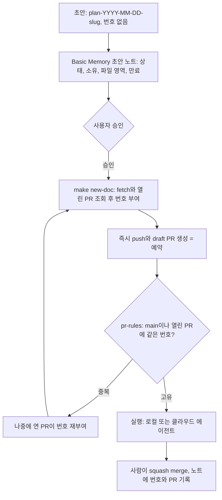

# 여러 기기·여러 벤더의 에이전트가 진행 중인 스펙·계획 초안과 번호를 어떻게 공유하고 충돌을 피하나

- 기준: 2026-10-22 시점의 스냅샷이다. 이후 바뀐 사실은 반영하지 않는다. 저장소 안 사실은 `main` 1d06037와 `work/web-connector` 기준이다.
- 표기: `Verified`는 1차 출처(공식 문서, README, 소스, issue 본문)를 그날 직접 읽은 사실이다. 단일 소규모 프로젝트의 issue나 ADR도 직접 읽었으면 `Verified`로 두되 일반화 근거가 약하다고 적었다. `Reported`는 2차 글, 검색 결과 사본, 벤더 주장, 사용자가 알려 준 사실이다. `Assumption`은 조사자의 해석이다.
- 방법: 네 주제(스펙 주도 도구, 에이전트 조정 계층, 문서 번호 체계, 공개 저장소의 초안 처리)를 서브에이전트 넷이 나눠 공식 문서, GitHub 소스와 issue, 웹 검색으로 조사했다. 이 조사 뒤의 사용자 결정은 [문서 고유 ID와 초안 보드 설계](../specs/spec-2026-10-23-q3jxc77k-doc-ids-and-draft-board.md) §1에 있다. 사용자는 B+F를 골랐고, 그 뒤 순번 대신 고유 키(nanoid 등)로 문서를 구분하기로 해서 이 조사가 추천한 "승인 때 번호 부여"는 바뀔 예정이다.

번호 충돌은 각 체크아웃이 "최댓값 + 1"을 계산하는 한 피할 수 없고, 막으려면 모두가 거치는 한 지점에서 할당을 직렬화하거나 번호를 버려야 한다. push 전 초안을 다른 기기와 벤더에 보여 주는 저장소 기반 도구는 없어서, 공유하려면 저장소 밖의 공유 저장소(트래커, 공용 서버, 이 저장소의 Basic Memory)나 이른 push가 필요하다. 공개 저장소에서는 draft PR도 공개이고 push한 내용은 회수되지 않으므로, 승인 전 초안을 비공개로 두려면 별도 매체가 필요하다.

## 1. 로컬 "최댓값 + 1"은 사람·도구·에이전트를 가리지 않고 충돌한다

**Verified:** adr-tools의 `adr new`는 로컬 디렉터리를 `ls`해 가장 큰 번호에 1을 더한다. git이나 원격은 전혀 보지 않는다([adr-tools src/adr-new](https://github.com/npryce/adr-tools/blob/HEAD/src/adr-new)). 이 문제를 다룬 adr-tools #102와 MADR #28은 **2020-10-12에 열려 2026-10-22 현재도 열려 있다**. 두 개발자가 각자의 PR에서 ADR 6을 고르면 "이름이 다른 두 ADR이 같은 번호를 갖는다"는 시나리오가 그대로 적혀 있다([npryce/adr-tools#102](https://github.com/npryce/adr-tools/issues/102), [adr/madr#28](https://github.com/adr/madr/issues/28)). GitHub Spec Kit v1.2.2의 코어 스크립트도 로컬 `specs/`만 훑어 `HIGHEST + 1`을 쓴다. 2026-07-24에 머지된 PR #1829는 이 점검이 "의도적으로 로컬 스펙 디렉터리만 본다"고 밝혔다([create-new-feature.sh](https://github.com/github/spec-kit/blob/HEAD/scripts/bash/create-new-feature.sh), [spec-kit#1829](https://github.com/github/spec-kit/pull/1829)). 번들 git 확장은 `git fetch --all --prune` 뒤 모든 로컬·원격 브랜치까지 본다([create-new-feature-branch.sh](https://github.com/github/spec-kit/blob/HEAD/extensions/git/scripts/bash/create-new-feature-branch.sh)). 그래도 동시에 두 번 실행하면 "둘 다 같은 번호를 고르고 두 번째가 첫 번째 스펙을 조용히 덮어쓴다"는 #4270이 열려 있다([spec-kit#4270](https://github.com/github/spec-kit/issues/4270)). 여러 개발자의 번호 충돌을 물은 #4418에 메인테이너는 락 대신 `SPECIFY_FEATURE_DIRECTORY`·`GIT_BRANCH_NAME` 환경변수로 사람이 이름을 직접 정하라고 답했다([spec-kit#4418](https://github.com/github/spec-kit/issues/4418)). #975에는 수정 후에도 에이전트가 가드를 우회했다는 댓글이 달렸다. `speckit.specify` 프롬프트가 에이전트에게 번호를 명시적으로 넘기라고 지시했기 때문이다([spec-kit#975](https://github.com/github/spec-kit/issues/975)).

**Verified (단일 소규모 프로젝트 사례):** 2026년의 병렬 에이전트 저장소에서도 같은 일이 되풀이됐다. kamp-us/phoenix에서는 동시에 돈 두 에이전트 레인이 각자 "다음 빈 번호"를 계산했다. 둘 다 **ADR 0198**을 만들었고 두 PR 모두 CI를 통과했다. 검증기가 자기 체크아웃 트리 안의 중복만 보기 때문이다([kamp-us/phoenix#3779](https://github.com/kamp-us/phoenix/issues/3779)). copper-mcp에서는 main의 식별자 여섯 개가 각각 서로 무관한 기록 두 개를 가리키게 됐다([copper-mcp#83](https://github.com/seunghyukchoe/copper-mcp/issues/83)). unsorry에서는 두 PR이 따로 ADR-059를 골라 **약 40초 간격으로 머지됐다**([unsorry ADR-061](https://unsorry.agentics.org.nz/docs/adrs/ADR-061-Unique-ADR-Numbering-Gate.html)). laurigates/claude-plugins의 검사 스크립트는 이 문제를 "ADR 번호는 브랜치 시점에 골라지지만 머지 시점에야 확정된다"는 한 문장으로 요약한다([check-adr-numbers.sh](https://github.com/laurigates/claude-plugins/blob/main/blueprint-plugin/skills/blueprint-adr-validate/scripts/check-adr-numbers.sh)).

**Reported (사용자 제공 사실과 관찰):** 이 저장소의 `make new-doc`는 로컬·원격 추적 브랜치와 현재 worktree 파일까지 보므로 adr-tools보다 범위가 넓다. 그래도 다른 worktree에서 커밋하지 않은 초안과 다른 머신에서 push하지 않은 작업은 보지 못한다. 2026-10-22의 충돌은 이 틈에서 났다. 한 에이전트가 커밋하지 않은 스펙 본문에 "plan 24"라고만 적어 두었고, 다른 에이전트의 `make new-doc`가 24를 다시 내주었다. 이 worktree의 `docs/plans/`에도 `plan-2026-10-22-23-...` 다음 파일이 `plan-2026-10-22-d3dpb00s-web-connector.md`다.

**Assumption:** 이 사고는 도구 버그가 아니라 구조 문제다. 예약이 어떤 공유 매체에도 기록되지 않았다. 본문에 적은 번호는 어떤 할당기도 읽을 수 없으므로, 할당기가 보는 범위를 Spec Kit처럼 원격 브랜치까지 넓혀도 막지 못한다. 원격 추적 브랜치는 마지막 fetch 시점의 사본이어서, 할당 직전에 fetch하지 않으면 이미 push된 예약도 놓친다. 또 Spec Kit #975가 보여 주듯 에이전트 지시문에 넣은 규칙은 우회된다. 가드는 할당기와 CI에 두어야 한다.

## 2. 오래된 프로세스는 네 가지 직렬화 지점 중 하나를 골랐다

**Verified (외부 카운터 빌리기):** Rust RFC는 `text/0000-my-feature.md`로 시작하며 "아직 RFC 번호를 정하지 말라, PR 번호가 번호가 된다"고 안내한다. Ember도 같다([rust-lang/rfcs](https://github.com/rust-lang/rfcs/blob/HEAD/README.md), [emberjs/rfcs](https://github.com/emberjs/rfcs/blob/HEAD/README.md)). Kubernetes KEP와 Go 제안은 순서를 뒤집는다. 추적 issue를 먼저 만들고 그 번호로 디렉터리·파일 이름을 지으므로 나중에 이름을 바꿀 일이 없다([KEP 템플릿](https://github.com/kubernetes/enhancements/blob/HEAD/keps/NNNN-kep-template/README.md), [golang/proposal](https://github.com/golang/proposal/blob/HEAD/README.md)). 2026년의 한 저장소는 ADR을 `<issue#>-<slug>`로 짓는 이유로 "issue를 여는 순간 그 번호가 전역으로 예약된다"를 들었다([LoganDark/get-shit-done ADR](https://github.com/LoganDark/get-shit-done/tree/jj-vcs/docs/adr)).

**Verified (늦게 붙이기):** Python PEP 1에서는 작성자가 "공개됐거나 PR에 올라온 PEP가 쓰지 않은 다음 번호"를 고른다. 편집자는 초안을 머지할 때 그 번호를 확인하거나 직접 부여한다. 열린 PR이 사실상 약한 예약 구실을 한다([PEP 1](https://github.com/python/peps/blob/HEAD/peps/pep-0001.rst)). Node.js EP는 파일 이름을 문자 그대로 `XXX-title-ish.md`로 시작하게 하고 "EP가 착지할 때" 번호를 붙였다([nodejs/node-eps](https://github.com/nodejs/node-eps/blob/HEAD/README.md)). IETF는 초안을 `draft-<저자>-<주제>-<버전>` 이름으로만 부르고 RFC 번호는 출판 직전에 부여한다. RFC 4714는 조기 할당을 검토했지만 "확실한 필요를 확인하지 못했다"고 적었다([IETF 초안 이름 규칙](https://authors.ietf.org/naming-your-internet-draft), [RFC 4714 §3.8](https://www.rfc-editor.org/rfc/rfc4714.html)). OpenJDK JEP는 게시 시점에 번호를 붙이고, 그 전에는 초안 이름으로 서로를 참조한다([JEP 1](https://openjdk.org/jeps/1)). Kubernetes는 새 KEP를 **`draft-YYYYMMDD-my-title.md`** 이름으로 체크인하도록 허용한다([KEP-0000](https://github.com/kubernetes/enhancements/blob/master/keps/sig-architecture/0000-kep-process/README.md)). Swift Evolution은 저장소에 들어간 제안 파일은 이름을 바꾸지 말라고 한다([swift-evolution process.md](https://github.com/swiftlang/swift-evolution/blob/HEAD/process.md)). **Reported:** RFC Editor FAQ의 "RFC 번호는 예약하지 않으며 출판 과정의 마지막 순간에 부여한다"는 문장은 검색 결과 사본으로만 읽었다([RFC Editor FAQ](https://www.rfc-editor.org/faq/)). Swift에서 리뷰 매니저가 SE 번호를 정한다는 통념은 원문에서 확인하지 못했다.

**Verified (번호를 버리거나 장식으로 낮추기):** log4brains는 2020-10-16 자체 ADR에서 번호를 버렸다. 두 개발자가 각자 브랜치에서 새 ADR을 만들면 `git merge` 때 문제가 생긴다는 이유였고, `YYYYMMDD-slug` 형식의 slug를 고유 ID로 삼았다([log4brains ADR](https://github.com/thomvaill/log4brains/blob/HEAD/docs/adr/20201016-use-the-adr-slug-as-its-unique-id.md)). OpenSpec 메인테이너는 번호 접두어 요청을 "팀이나 worktree에서 병렬로 변경을 만들면 깨진다"며 거절했다. 그래서 변경 이름은 kebab-case뿐이다([OpenSpec#1169](https://github.com/Fission-AI/OpenSpec/issues/1169)). Agent OS는 `YYYY-MM-DD-HHMM-slug` 폴더를 쓴다([agent-os shape-spec.md](https://github.com/buildermethods/agent-os/blob/main/commands/agent-os/shape-spec.md)). 마이그레이션 도구가 이 길을 먼저 걸었다. Rails는 2008년에 UTC 타임스탬프로 바꾸며 다른 브랜치가 같은 번호를 받는 문제를 "거의 없앤다"고 했다([rails@c00de99](https://github.com/rails/rails/commit/c00de99f69358b58ca2bd6bc732e2de1b667800e)). Django는 번호를 개발자 참고용으로만 두고 의존 그래프로 충돌을 감지한다([Django migrations](https://docs.djangoproject.com/en/stable/topics/migrations/)). Alembic은 해시형 리비전 ID와 명시적 merge 리비전으로 DAG를 푼다([Alembic branches](https://alembic.sqlalchemy.org/en/latest/branches.html)). changesets는 "git 충돌을 피하는 고유 해시면 충분하다"는 주석과 함께 사람이 읽을 수 있는 무작위 이름을 쓰고, towncrier는 issue ID를 쓴다([changesets](https://github.com/changesets/changesets/blob/HEAD/packages/write/src/index.ts), [towncrier](https://github.com/twisted/towncrier/blob/HEAD/docs/tutorial.rst)). 반대로 번호를 지키기로 한 쪽도 있다. MADR은 `ADR-0001`처럼 짧게 인용할 수 있다는 이유로 `NNNN`을 유지했다([MADR ADR-0005](https://github.com/adr/madr/blob/HEAD/docs/decisions/0005-use-dashes-in-filenames.md)). unsorry는 해시·문자 ID를 거부하고 "순번은 확립된 관례이자 인용 핸들이므로 바꾸지 말고 지켜야 한다"고 결정했다([unsorry ADR-061](https://unsorry.agentics.org.nz/docs/adrs/ADR-061-Unique-ADR-Numbering-Gate.html)).

**Verified (레지스트리, CI 게이트, git을 락으로 쓰기):** adr-tools #102는 마지막 번호를 담은 락 파일을 같은 PR에서 고치게 하자고 제안했다. 그러면 두 번째 머지가 충돌한다. 단점으로는 "개발자가 락 파일 수정을 잊을 수 있다"를 들었다. 하나뿐인 댓글은 날짜를 쓰라고 하거나, 전용 브랜치 같은 외부 시퀀서를 두라고 했다. 다만 그러면 "번호 할당이 API 호출이 된다"고 덧붙였다([adr-tools#102](https://github.com/npryce/adr-tools/issues/102)). copper-mcp는 ID 공간마다 한 줄짜리 레지스트리를 두고 검사기로 실제 파일과 맞췄다. 같은 다음 번호를 고른 두 브랜치는 이제 텍스트로 충돌해 git이 머지를 거부한다. 이미 인용된 번호는 바꾸지 않고 정정 주석만 붙였다([copper-mcp#83](https://github.com/seunghyukchoe/copper-mcp/issues/83)). unsorry는 PR 게이트가 base 트리와 겹치는 ADR 번호를 실패시키게 했다. 그래도 두 PR이 같은 base에서 갈라져 최신 base를 요구하지 않는 검사로 머지되면 둘 다 들어갈 수 있다. 이 마지막 창은 브랜치 보호의 "require branches up to date"로 닫는다고 적었다([unsorry ADR-061](https://unsorry.agentics.org.nz/docs/adrs/ADR-061-Unique-ADR-Numbering-Gate.html)). kamp-us는 대안 세 가지를 들었다. 번호 예약 명령, 머지 시점 번호 부여, 열린 PR의 추가 파일까지 읽는 CI 가드다. 마지막 것은 "가장 싸지만 실시간 PR 상태라는 실패 지점을 떠안는다". 또 "CI가 두 번째로 도는 PR이 빨개지는데, 그것이 번호를 바꿔야 할 PR이 아닐 수 있다"고 지적했다([kamp-us/phoenix#3779](https://github.com/kamp-us/phoenix/issues/3779)). laurigates는 파일 이름만 보고 front matter의 `id:`를 무시하다가 실제 충돌을 놓친 적이 있다([check-adr-numbers.sh](https://github.com/laurigates/claude-plugins/blob/main/blueprint-plugin/skills/blueprint-adr-validate/scripts/check-adr-numbers.sh)). Anthropic이 Claude 16개를 병렬로 돌린 실험은 git 자체를 락으로 썼다. 에이전트는 공유 bare 저장소의 `current_tasks/`에 텍스트 파일을 써서 push했다. 같은 작업을 잡으려던 두 번째 에이전트는 git 동기화 때문에 다른 작업을 골라야 했다([Building a C compiler with a team of parallel Claudes](https://www.anthropic.com/engineering/building-c-compiler)). 오케스트레이터가 있다면 브리프에 ID를 미리 나눠 주라는 권고도 있다. 근거는 "'다음 빈 ID를 고르라'는 병렬 환경에서 경쟁 조건"이라는 것이다([laurigates parallel-agent-dispatch](https://github.com/laurigates/claude-plugins/blob/main/agent-patterns-plugin/skills/parallel-agent-dispatch/SKILL.md)).

**Assumption:** 어떤 방식이 통하는지는 할당이 어딘가에서 직렬화되는지로 갈린다. GitHub 카운터, 게이트키퍼, git이 텍스트 충돌을 내는 파일, 최신 base를 요구하는 필수 검사가 그런 지점이다. 직렬화 지점 없이 브랜치 안에서만 계산하는 "최댓값 + 1"은 사람이든 도구든 에이전트든 경쟁한다. 이름을 바꾸는 비용은 번호가 인용된 뒤 급격히 커진다(copper-mcp, unsorry). 그래서 번호를 늦게 붙이려면 초안 단계에서는 slug로만 부른다는 규칙이 함께 필요하다. 타임스탬프는 충돌을 줄일 뿐 없애지는 못한다(MADR #28의 메인테이너 분석). 날짜만 쓰는 접두어는 slug가 붙어야 고유해진다.

## 3. git 기반 도구는 push 전 초안을 다른 머신에 보여 주지 못한다

**Verified (스펙 주도 도구):** 조사한 도구는 모두 저장소 안의 Markdown 폴더와 git을 공유 수단으로 쓴다. Spec Kit은 `specs/NNN-slug/`에 초안을 두며, git 확장의 auto-commit은 기본적으로 꺼져 있고 push 명령은 아예 없다([git 확장 config-template.yml](https://github.com/github/spec-kit/blob/main/extensions/git/config-template.yml), [git 확장 README](https://github.com/github/spec-kit/blob/main/extensions/git/README.md)). OpenSpec은 "커밋·브랜치·push·pull을 절대 하지 않는다"고 밝힌다. 계획 전용 저장소인 Stores(베타)도 "그냥 git 저장소"라서, 변경은 "커밋하고 push하기 전까지 당신의 체크아웃에만 존재한다"([OpenSpec team-workflow](https://github.com/Fission-AI/OpenSpec/blob/main/docs/team-workflow.md), [OpenSpec stores user guide](https://github.com/Fission-AI/OpenSpec/blob/main/docs/stores-beta/user-guide.md)). Kiro는 스펙을 저장소에 커밋하라고 하고, 여러 팀이 함께 쓰는 스펙은 중앙 스펙 저장소와 서브모듈로 다루라고 권한다(요약 도구를 거쳐 읽음)([Kiro best practices](https://kiro.dev/docs/specs/best-practices/)). BMAD는 계획 저장소를 "자체 `git init`"으로 따로 두라고 한다. 외부 트래커 연동에 대해서는 "아직 훅이 없어 아무것도 저절로 동기화되지 않는다"고 적었다([BMAD set-up-the-ticket-tree](https://github.com/bmad-code-org/BMAD-METHOD/blob/main/docs/plan/set-up-the-ticket-tree.md)). Backlog.md만 한 걸음 더 갔다. 2026-07-01에 머지된 PR #710은 **형제 worktree에서 커밋하지 않은 파일까지 다음 ID 계산에 넣고**, 생성 락을 git common directory로 옮겨 같은 clone의 worktree들이 락을 공유하게 했다([Backlog.md#710](https://github.com/MrLesk/Backlog.md/pull/710)). 승인 전 초안을 언제 원격에 올리라는 공식 지침은 어느 도구에도 없었다. OpenSpec은 팀 검토를 코드와 같은 PR에서 하고, Agent OS는 승인 뒤에야 스펙을 디스크에 쓴다([OpenSpec team-workflow](https://github.com/Fission-AI/OpenSpec/blob/main/docs/team-workflow.md), [agent-os shape-spec.md](https://github.com/buildermethods/agent-os/blob/main/commands/agent-os/shape-spec.md)). 병렬 실행 충돌을 보고한 issue를 BMAD 메인테이너는 worktree를 쓰라며 wontfix로 닫았다([BMAD#1750](https://github.com/bmad-code-org/BMAD-METHOD/issues/1750)).

**Verified (조정 계층):** beads는 v1.0.0(2026-04-02)부터 Dolt 데이터베이스이고, 머신 간 동기화는 프로젝트 git 원격의 `refs/dolt/data`에 `bd dolt push/pull`하는 방식이다. 해시 ID(`bd-a1b2`)로 ID 충돌은 막는다([beads README](https://github.com/gastownhall/beads), [beads FAQ](https://github.com/gastownhall/beads/blob/main/docs/reference/faq.md)). 하지만 원자적이라는 `--claim`이 동시 호출에서 둘 다 성공하는 문제가 열려 있다. 부하 테스트에서는 **2-way 경쟁 5회 모두 양쪽이 성공했다**([beads#4657](https://github.com/gastownhall/beads/issues/4657), [beads#3575](https://github.com/gastownhall/beads/issues/3575)). 두 clone이 동기화 전에 같은 issue에 댓글을 달면 한쪽 댓글이 사라지는 문제도 2026-10-21에 열렸다([beads#7757](https://github.com/gastownhall/beads/issues/7757)). MCP Agent Mail(Rust)은 Claude Code·Codex CLI·Gemini CLI를 지원하는 HTTP MCP 서버로, TTL이 있는 권고형 파일 예약(lease)을 제공한다. 다만 기본 바인드가 `127.0.0.1:8765`이고, 외부에 열 때는 bearer 토큰이 필요하며, 프로젝트 키가 저장소의 절대 경로다. 스스로 "git worktree를 쓰지 말라"는 입장이기도 하다([mcp_agent_mail_rust](https://github.com/Dicklesworthstone/mcp_agent_mail_rust)). Claude Code의 agent teams와 세션 간 메시징은 Claude 전용이다([agent teams](https://code.claude.com/docs/en/agent-teams), [cross-session messaging](https://code.claude.com/docs/en/cross-session-messaging)). Codex cloud는 작업마다 자기 workspace를 가지며, 공유 보드나 작업 간 락은 문서에 없다([Codex cloud](https://learn.chatgpt.com/docs/cloud)). 각 도구의 내장 계획 디렉터리는 머신 로컬 임시 공간이다. Claude Code의 `~/.claude/plans/`와 Gemini CLI의 `~/.gemini/tmp/<project>/<session>/plans/`는 기본 30일 뒤 지워진다([Claude Code .claude 디렉터리](https://code.claude.com/docs/en/claude-directory), [Gemini CLI Plan Mode](https://geminicli.com/docs/cli/plan-mode/)). **Reported:** Codex가 계획을 독립 Markdown 파일이 아니라 `~/.codex/sessions/.../rollout-*.jsonl` 안에 남긴다는 설명은 2차 글에서 나왔다([zenn.dev](https://zenn.dev/t__nabe/articles/e075c352723d9c)). 별도 계획 디렉터리를 요청한 issue가 열려 있다는 사실은 확인했다([openai/codex#19125](https://github.com/openai/codex/issues/19125)). Ruflo의 머신 간 federation 주장과 mem0의 동시성 버그 보고는 벤더 주장이거나 2차 보고라 판단 근거로 쓰지 않았다.

**Assumption:** 머신과 벤더를 함께 넘어 진행 중 작업을 보이게 하는 수단은 세 부류다. 첫째는 MCP로 닿는 호스팅 트래커(GitHub Issues/Projects, Linear)로, 서버가 ID를 원자적으로 내준다. 둘째는 모든 에이전트가 같은 주소로 붙는 하나의 권위 있는 서버(Agent Mail, `bd serve`, 자체 호스팅 노트 저장소)다. 셋째는 이른 git push다. Conductor·ccmanager 같은 worktree 관리 도구는 한 머신 안의 격리만 해결한다. 어떤 잠금·예약 설계든 만료가 있어야 한다. 에이전트는 죽거나 리셋되므로, Agent Mail의 TTL 같은 만료가 없는 예약은 영구 락이 된다. 이 저장소에서 beads를 기본 설정으로 쓰면 `refs/dolt/data`가 공개 원격에 push되어 계획 텍스트가 공개된다(`--stealth`나 별도 계획 저장소로 피할 수 있다). Agent Mail은 lease를 벤더 공통으로 제공하는 유일한 도구다. 그러나 worktree를 반대하는 설계라서 에이전트당 worktree 하나를 쓰는 이 저장소의 방식과 맞지 않는다.

## 4. 공개 저장소의 초안은 회수할 수 없고, 공개 우선 관행은 기밀 없는 초안을 전제한다

**Verified (오픈소스 프로세스):** Rust는 Zulip과 포럼의 pre-RFC로 시작하고, PR에 공개된 커밋은 squash나 rebase를 하지 말라고 한다([rust-lang/rfcs](https://github.com/rust-lang/rfcs/blob/master/README.md)). Python은 Discourse Ideas에서 먼저 공개 검증을 받으라고 하며, 그 이유를 작성자의 시간을 아끼기 위해서라고 설명한다. 저장소의 개정 이력은 곧 기능 제안의 역사 기록이라고 본다([PEP 1](https://peps.python.org/pep-0001/)). Kubernetes 템플릿은 **"일찍 머지하고 반복하라"**고 한다. `provisional` KEP는 머지되어도 승인된 것이 아닌 작업 문서이고, 다툼이 있는 부분은 `<<[UNRESOLVED ...]>>`로 표시한다([KEP 템플릿](https://raw.githubusercontent.com/kubernetes/enhancements/master/keps/NNNN-kep-template/README.md)). Go는 "누구나 참여할 수 있도록" issue tracker에서 논의하고([golang/proposal](https://github.com/golang/proposal/blob/master/README.md)), Swift는 포럼의 pitch에서 시작한다([swift-evolution process.md](https://github.com/swiftlang/swift-evolution/blob/main/process.md)). 다섯 프로세스 어디에도 비공개 사전 초안 단계는 없었다.

**Verified (GitHub의 경계):** draft PR은 머지할 수 없고 코드 소유자에게 리뷰 요청이 자동으로 가지 않을 뿐이다([About pull requests](https://docs.github.com/en/pull-requests/collaborating-with-pull-requests/proposing-changes-to-your-work-with-pull-requests/about-pull-requests)). **공개 저장소의 포크는 모두 공개이고 가시성을 바꿀 수 없다.** 포크를 지워도 그 커밋은 저장소 네트워크에서 계속 접근할 수 있다([포크 가시성](https://docs.github.com/en/pull-requests/collaborating-with-pull-requests/working-with-forks/about-permissions-and-visibility-of-forks)). 저장소를 공개로 바꾸면 push 룰셋은 모두 비활성화된다([저장소 가시성 설정](https://docs.github.com/en/repositories/managing-your-repositorys-settings-and-features/managing-repository-settings/setting-repository-visibility)). Discussions는 저장소의 가시성을 물려받는다([Discussions quickstart](https://docs.github.com/en/discussions/quickstart)). secret gist도 비공개가 아니다([gist 만들기](https://docs.github.com/en/get-started/writing-on-github/editing-and-sharing-content-with-gists/creating-gists)). 반면 사용자 소유 Projects는 비공개로 둘 수 있고, draft issue는 프로젝트 안에만 존재한다([Projects 가시성](https://docs.github.com/en/issues/planning-and-tracking-with-projects/managing-your-project/managing-visibility-of-your-projects), [Projects 항목 추가](https://docs.github.com/en/issues/planning-and-tracking-with-projects/managing-items-in-your-project/adding-items-to-your-project)). Truffle Security는 지운 포크와 지운 저장소의 데이터를 커밋 해시로 읽을 수 있음을 보였고, GitHub는 설계상 동작이라고 답했다. force-push로 지운 커밋을 GH Archive 로그로 찾아 비밀을 수집한 사례도 있다([Truffle Security 2024](https://trufflesecurity.com/blog/anyone-can-access-deleted-and-private-repo-data-github), [Truffle 게스트 포스트](https://trufflesecurity.com/blog/guest-post-how-i-scanned-all-of-github-s-oops-commits-for-leaked-secrets)). 2024년에는 Google Content Warehouse API의 내부 문서가 봇의 커밋으로 공개 저장소에 올라갔다. 약 두 달 동안 공개됐고, 삭제되기 전에 제3자 색인에 복사됐다([Wikipedia](https://en.wikipedia.org/wiki/2024_Google_Search_documentation_leak), [Ars Technica](https://arstechnica.com/gadgets/2024/06/google-accidentally-published-internal-search-documentation-to-github/)). GitGuardian은 2025년 공개 GitHub 커밋에서 새로 노출된 비밀을 **2,865만 개** 셌다. Claude Code가 공동 작성한 커밋의 키 유출률은 **3.2%로 기준선 1.5%의 두 배**였다고 보고했다([GitGuardian State of Secrets Sprawl 2026](https://blog.gitguardian.com/the-state-of-secrets-sprawl-2026/)). GitHub push protection은 알려진 비밀 형식만 막고, 사용자 정의 패턴은 조직 저장소에서만 쓸 수 있다([About push protection](https://docs.github.com/en/code-security/secret-scanning/introduction/about-push-protection)).

**Verified (에이전트 워크플로 작성자들의 세 진영):** superpowers 메인테이너는 계획과 스펙이 설계 의도를 이해하는 데 유용한 산출물이므로 git에 커밋해야 한다는 입장이다([obra/superpowers#807](https://github.com/obra/superpowers/issues/807)). BoostV는 계획을 브랜치와 PR에서는 보이게 두었다가 머지 전 정리 커밋으로 지운다([BoostV ADR 0002](https://github.com/BoostV/process-optimizer-frontend/blob/main/docs/adr/0002-adrs-and-ephemeral-agent-docs.md)). SocketDev는 계획을 저장소 루트의 추적하지 않는 `.claude/plans/`에 둔다. worktree를 지우면 함께 사라진다는 단점은 인정한다([SocketDev plan-storage](https://github.com/SocketDev/socket-registry/blob/main/docs/claude.md/fleet/plan-storage.md)). `.git/info/exclude`는 공유할 필요가 없는 저장소별 패턴을 두는 곳이다([gitignore](https://git-scm.com/docs/gitignore)). clone에 따라가지 않으므로 다른 머신에서는 다시 설정해야 한다([hkdocs](https://hkdocs.com/en/blog/2026/07/01/claude-code-local-docs-without-public-traces/)). 저장소 안 암호화도 메타데이터는 숨기지 못한다. git-crypt는 파일 이름과 커밋 메시지를 암호화하지 않고, 변경 시점·길이·동일성도 드러나며, 키 회수를 지원하지 않는다([git-crypt](https://www.agwa.name/projects/git-crypt/)). Claude Code는 도구를 거친 모든 내용을 평문 대화 기록으로 디스크에 남긴다([Claude Code .claude 디렉터리](https://code.claude.com/docs/en/claude-directory)).

**Assumption:** 오픈소스 프로세스가 초안을 공개하는 근거는 세 가지다. 외부 피드백을 받고, 결정 기록 자체가 산출물이며, 초안에 기밀이 없다는 것이다. 이 사용자에게는 세 번째가 성립하지 않을 수 있다. 이 저장소는 VM의 외부·tailnet IP를 커밋에 쓰지 말라는 규칙을 이미 두고 있고, 사용자의 전역 규칙은 초안을 커밋할 때 승인을 요구한다. draft PR은 이름과 달리 공개 범위를 바꾸지 않는다. 공개 네트워크에 들어간 내용은 삭제나 force-push로 되돌릴 수 없으므로, 효과가 있는 통제는 push 전 예방뿐이다. `.git/info/exclude`는 같은 clone의 worktree끼리는 공유되지만 머신을 넘지 못한다. 비공개를 유지하면서 머신을 넘으려면 git 밖의 수단이나 별도 비공개 저장소 같은 운반 수단이 하나 더 필요하다. 그리고 공개 저장소에서 클라우드 에이전트가 볼 수 있는 것은 곧 누구나 볼 수 있는 것이다.

## 5. 이 저장소에서는 번호 문제와 초안 공유 문제를 분리해야 한다

**Reported (사용자 제공 사실과 저장소 관찰):** 이 저장소는 공개 저장소다. 에이전트 하나가 worktree 하나를 쓰고, `work/`·`plan/` 브랜치에서 작업하며, 기계 계정이 draft PR을 열고, 사람이 squash merge한다. AGENTS.md는 plan 번호를 브랜치 이름 `plan/<NN>-<slug>`와 모든 커밋의 트레일러 `Plan: <NN|none>`에 쓰게 한다(`AGENTS.md:31`, `AGENTS.md:33`). 문서 파일 이름에는 이미 날짜와 slug가 들어 있다. 스펙은 `spec-2026-10-22-tn23wwmd-web-connector.md`처럼 번호가 없고, 계획은 `plan-2026-10-22-d3dpb00s-web-connector.md`, ADR은 `adr-2026-10-22-fcvznmdc-web-connector.md`처럼 날짜와 slug 사이에 번호가 낀다(이 worktree의 `docs/` 목록). Basic Memory는 1 GB VM에 있고 SSH 터널이 열려 있을 때만 닿는다. 사용자 메모리에는 Claude Code와 Codex가 터널 주소로 연결되어 있다고 기록되어 있다. 그런데 이 보고서를 쓰는 세션에서는 `basic-memory` MCP 연결이 ECONNREFUSED로 실패했다.

**Assumption (번호):** 첫째, 모든 머신·벤더·클라우드 실행 환경이 반드시 지나는 지점은 GitHub PR 하나뿐이다. 그러므로 중복 번호 가드는 에이전트 지시문이 아니라 `pr-rules` CI에 두어야 하고, origin/main뿐 아니라 열린 PR들도 검사해야 한다. 이 저장소는 plan 번호가 브랜치 이름에 들어 있어서, 열린 PR의 head 브랜치 이름만 훑어도 다른 PR들이 가진 plan 번호가 보인다. kamp-us가 막혔던 지점이 여기서는 쉽게 풀린다. ADR은 열린 PR이 추가한 파일 목록과 front matter를 함께 봐야 laurigates의 실수를 피한다(Actions 기본 토큰으로 열린 PR을 조회할 수 있는지는 확인하지 않았다). 둘째, 번호는 첫 커밋부터 트레일러와 브랜치 이름에 필요하다. 그래서 IETF식 "머지 때 부여"는 맞지 않고 "승인 때 부여"가 맞다. 승인 전 계획 초안은 스펙처럼 번호 없이 `plan-YYYY-MM-DD-<slug>`로 부른다(Kubernetes `draft-YYYYMMDD`, Node `XXX-` 선례). 사용자가 승인하면 `make new-doc`가 할당 직전에 fetch(또는 `git ls-remote`)와 열린 PR 조회를 하고 번호를 끼워 넣는다. 그 즉시 브랜치를 push하고 draft PR을 연다. 이렇게 하면 PR을 여는 순간이 곧 예약이 되고, 남는 틈은 할당에서 push까지의 몇 분뿐이다. 그 틈에서 생긴 충돌도 CI가 잡는다. 룰셋이 이미 최신 base를 요구하는지는 확인하지 않았다. 셋째, 같은 Mac의 worktree끼리는 Backlog.md처럼 `git worktree list`로 형제 worktree의 커밋하지 않은 문서까지 훑으면 2026-10-22 유형의 충돌 대부분을 막는다. 다만 본문에 적은 예약은 어떤 할당기도 읽지 못하므로, 초안에서 다른 계획을 번호가 아니라 slug로 부른다는 규칙이 함께 있어야 한다. 넷째, 번호 자체는 유지할 가치가 있다. 사용자와 에이전트가 "plan 25", "ADR 0008"로 소통하고 메모리에도 그렇게 남는다. unsorry의 결론처럼 번호를 바꾸기보다 지키는 편이 싸다.

**Assumption (초안 공유):** 번호를 git과 CI로 옮기면 초안 저장소는 정확성을 책임지지 않고 발견만 책임진다. 누가 무엇을 쓰고 있고 어떤 파일을 건드리는지 보여 주면 된다. 그러면 Basic Memory의 약점인 터널 의존과 락 부재는 치명적이지 않다. 터널이 내려가면 다른 머신의 초안이 보이지 않을 뿐 번호가 꼬이지는 않는다. Basic Memory는 이미 Claude Code와 Codex에 MCP로 연결되어 있고, Gemini CLI도 MCP 클라이언트라 붙일 수 있다(설정은 확인하지 않았다). 노트 쓰기는 커밋이 아니므로 "초안 커밋은 승인 필요" 규칙과도 부딪히지 않는다. 각 초안 노트의 front matter에 상태, slug, 소유 머신과 벤더, 연결될 브랜치, 건드릴 파일 영역, 마지막 갱신 시각, 만료 시각을 둔다. 그러면 지금 다른 worktree 폴더를 직접 열어 읽던 일을 MCP 검색이 대신한다. 승인되면 노트에 번호와 PR 링크를 적고 본문을 저장소 문서로 옮긴다. 남는 약점은 셋이다. 클라우드 실행 환경은 Mac의 터널에 닿지 않는다. 여러 에이전트가 동시에 쓸 때의 동작은 문서에서 확인하지 못했다. Basic Memory에는 앱 인증이 없어 네트워크 경계가 유일한 보호다. 첫째 약점은 역할을 나눠 피할 수 있다. 클라우드 에이전트에는 승인되어 번호가 붙고 push된 계획만 맡기면 된다.

1. 승인 전 초안은 번호 없이 날짜와 slug로만 부르고, 다른 초안도 slug로 참조한다.
2. 초안 노트를 Basic Memory에 두어 다른 머신·벤더의 에이전트가 MCP로 찾게 한다.
3. 사용자가 승인한 순간에만 번호를 할당한다.
4. 할당 직전에 원격을 새로 고치고 열린 PR을 조회해 최신 상태에서 번호를 고른다.
5. 할당 즉시 push하고 draft PR을 열어, PR 자체를 모두가 보는 예약으로 만든다.
6. CI가 main과 열린 PR을 대조해 중복이면 실패시킨다.
7. 중복이면 나중에 연 PR이 아직 인용되기 전에 번호를 바꾼다.
8. 고유하면 로컬이든 클라우드든 어느 에이전트에게나 실행을 맡긴다.
9. 머지 후 노트에 결과를 기록해 보드를 닫는다.

## 6. 결론

이번 조사로 질문의 초점이 바뀌었다. "할당기가 얼마나 넓게 보는가"는 중요하지 않다. 중요한 것은 예약이 모든 참여자가 원자적으로 볼 수 있는 곳에만 존재하는가다. 본문 속 번호, 로컬 파일, 에이전트 대화에 있는 예약은 예약이 아니다. 이 저장소에서 머신·벤더·클라우드가 모두 원자적으로 보는 곳은 GitHub의 브랜치와 PR뿐이다. 그러니 번호는 계산 결과가 아니라 "PR을 연 사건"에서 생기게 하는 것이 자연스럽다. 여러 프로세스가 수십 년에 걸쳐 PR 번호, 병합 시 부여, 필수 검사로 수렴한 이유도 같다.

공개 저장소에서는 "다른 에이전트에게 보인다"와 "누구에게나 보인다"가 같은 다이얼로 움직인다. 이 다이얼을 둘로 나누려면 비공개 매체를 하나 더 두는 수밖에 없다. 그 매체가 번호의 정확성을 책임지지 않게 설계하면, 터널 뒤의 1 GB VM처럼 가용성이 낮은 매체로도 충분하다. 결국 남는 판단은 하나다. 사용자의 초안에 공개되면 안 되는 내용이 실제로 얼마나 자주 들어가는가. 드물다면 Kubernetes처럼 일찍 push하는 방식(A)에 B만 더해도 가장 단순한 답이 된다. 잦다면 아래 추천 조합이 맞다.

## 시사점: 선택지 비교와 추천

| 라벨 | 방안 | 번호 충돌 | 머신·벤더 간 초안 공유 | 공개 노출 | 주요 비용·위험 |
|---|---|---|---|---|---|
| A | 초안을 공개 저장소에 일찍 push(브랜치·draft PR) | push 후에는 `make new-doc`가 봄(fetch 필요). push 전 틈은 남음 | 모든 머신·벤더·클라우드에서 보임 | 초안 전체가 영구 공개, 회수 불가 | 사용자 규칙(초안 커밋은 승인 필요)과 충돌, 인프라 정보 유출 위험 |
| B | 승인 때 번호 부여, 초안은 날짜·slug, CI가 main과 열린 PR 대조 | 근본 원인(본문 예약) 제거. PR이라는 공통 경로에서 모든 실행 주체를 검사 | 해결하지 않음(저장 위치와 무관한 기반) | 승인된 문서만 공개 | `make new-doc`·bats 테스트·`pr-rules`·doc-authoring 스킬·AGENTS.md(사용자 승인) 수정, 충돌 시 나중 PR이 번호 재부여 |
| C | 번호 레지스트리 파일(main 또는 전용 브랜치) | main에 두면 머지 때 텍스트 충돌로 늦게 발견, 전용 브랜치면 push 거부로 직렬화 | 번호와 slug만 | 공개 저장소면 slug 공개 | 갱신 누락(CI 검증 필요), 할당이 "API 호출"이 됨, 1인 운영에는 과함 |
| D | GitHub issue·PR 번호를 문서 번호로 | 서버가 원자적으로 할당, 충돌 불가 | issue 본문이 공유 수단 | issue 제목·본문 공개 | 번호가 듬성듬성해짐, plan 01–25 체계와 단절, issue 생성은 공개 게시 |
| E | 비공개 동반 저장소(포크가 아닌 별도 저장소) | 비공개 레지스트리를 push 직렬화로 운용 가능 | 로컬 에이전트 모두 파일로 접근, git 이력, 오프라인 가능 | 비공개 | 머신마다 두 번째 clone, 잘못된 remote에 push하거나 복사·붙여넣기로 유출될 위험, Codex 샌드박스 쓰기 범위와 클라우드 접근은 미확인, 승인 후 옮기는 단계 |
| F | Basic Memory를 초안 저장소·작업 보드로 | 원자적 할당 수단 없음, B와 결합 필요 | MCP로 Claude Code·Codex 연결됨(Gemini는 미확인), 커밋 없음, 검색 가능 | 비공개(네트워크 경계로만 보호) | 터널이 있어야 접근(이 세션도 실패), 클라우드 실행 환경에서 닿지 않음, 동시 쓰기 동작 미확인 |
| G | 외부 트래커(Linear, 비공개 GitHub Project) | 서버 할당 ID | 호스팅 MCP, 클라우드 에이전트도 접근 가능 | 비공개 설정 시 비공개 | 새 서비스·계정, 본문이 버전 관리되는 Markdown이 아님, 승인 후 옮겨야 함 |
| H | 공개 저장소 안 암호화(git-crypt, SOPS) | 해결하지 않음 | git으로 공유, 키가 있는 머신만 평문 | 파일 이름·커밋 메시지·시점·크기 노출 | 필터가 빠지면 평문이 영구 커밋됨, 키 회수 불가, CI와 새 worktree에는 암호문으로 보임 |

**추천: B를 기반으로 깔고 그 위에 F를 얹는다. F가 맞지 않으면 E로 바꾼다.**

- **B가 기반인 이유:** 2026-10-22의 실패 유형(본문 속 예약)을 초안 저장 위치와 무관하게 없앤다. 회사 Mac, 개인 Mac, Codex 같은 클라우드 실행 환경은 모두 PR을 거치므로 B는 이들을 하나의 검증 기준으로 덮는다. 같은 이유로 가드를 에이전트 지시문이 아닌 CI에 둔다(Spec Kit #975의 교훈).
- **번호를 유지하는 이유:** 번호는 이미 사용자와 에이전트의 인용 핸들이다(unsorry의 결론). 파일 이름에 날짜와 slug가 이미 들어 있어서, "번호 없는 초안 이름"을 새로 만들 필요 없이 번호 자리만 비우면 된다.
- **F를 얹는 이유:** 커밋이 없어 사용자 규칙과 부딪히지 않는다. 이미 운영 중이고 공유 에이전트 메모리라는 목적에도 맞는다. 번호의 정확성을 책임지지 않으므로 터널이 끊겨도 발견만 잠시 막힐 뿐이다.
- **E로 바꿀 때:** 터널을 여는 수고가 잦거나, 초안의 diff 이력과 오프라인 접근이 필요하면 E가 낫다. E는 비공개라도 커밋이므로, 그 커밋에 승인 규칙을 적용할지는 사용자가 정해야 한다.
- **조건부:** A는 초안에 민감한 내용이 거의 없다는 판단이 서면 가장 단순한 선택이다. G는 클라우드 에이전트까지 비공개 초안을 읽어야 할 때 유일하게 깔끔한 답이다. 다만 지금 규모에서는 새 서비스를 들이는 비용이 크다.
- **비추천:** C는 B의 CI 게이트가 같은 일을 더 적은 수고로 한다. D는 기존 번호 체계를 끊고 issue 본문을 공개한다. H는 메타데이터가 새고 실수를 되돌릴 수 없다. beads와 Agent Mail은 기본 설정의 공개 push, 열려 있는 claim 경쟁 버그, worktree 반대 설계 때문에 이 저장소와 맞지 않는다.

이 추천은 조사 근거에 바탕한 판단일 뿐이며, 어느 조합을 채택할지는 사용자가 정한다. 판단의 갈림길은 결론에서 말한 질문이다. 사용자의 초안에 공개되면 안 되는 내용이 실제로 얼마나 자주 들어가는가.
