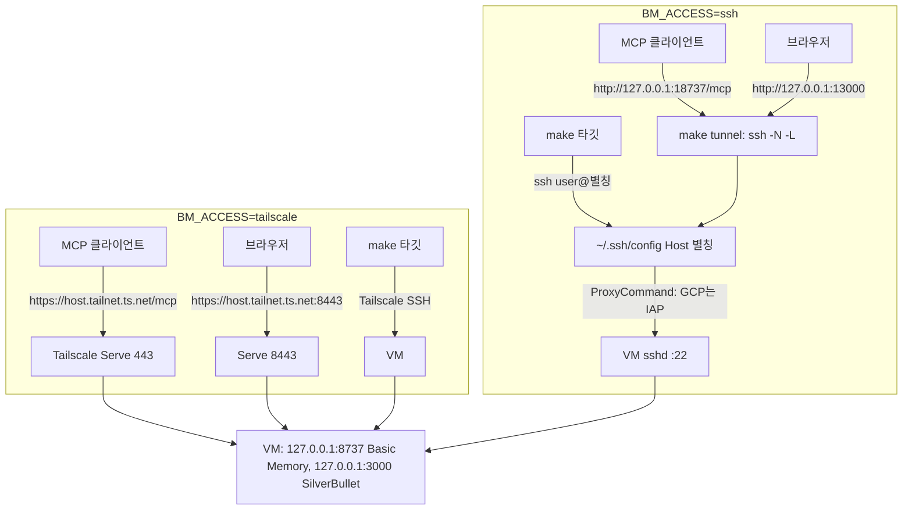

# VM 접속 방식 선택 (Tailscale 또는 SSH 터널) — 설계

- [GCP 설계](spec-2026-10-12-p5nmsc4m-basic-memory-gcp-tailscale.md)의 "tailnet 안에서만 접근" 전제를 "VM마다 접속 방식 하나"로 넓히고, [웹 UI 설계](spec-2026-10-14-cjerm8b4-silverbullet-web-ui.md)의 노출 방식을 그 위에 맞춘다. 모든 계획은 [GitHub PR 워크플로](spec-2026-10-13-pr762r68-github-pr-workflow.md)와 [git·리뷰 정책](spec-2026-10-07-restd5vd-git-review-policy.md)을 따른다.
- 구현 계획: `docs/plans/plan-2026-10-15-ctv444ep-access-modes.md` 하나에 배포까지 담는다.
  - Task 1~7: `BM_ACCESS` 설정, `make access-check`·`make tunnel`, 모드별 부트스트랩·`status`·`verify`, 런북·[access-modes ADR](../decisions/adr-2026-10-15-cz8c26gp-access-modes.md). VM에서는 아무것도 실행하지 않고 스텁으로 검증한다. 코드 PR로 병합한다.
  - Task 8: 코드 PR이 병합된 뒤 지금 VM(`agent-hub-01`)을 `ssh` 모드로 옮기고 사무실·집 네트워크에서 확인한다(사용자와 함께, 단계마다 OK). 결과는 결과 PR로 남긴다([vm-rollout 계획](../plans/plan-2026-10-07-qtvzskgx-vm-rollout.md)의 결과 PR #2와 같은 방식).
- 순서: [web-ui-vm-rollout 계획](../plans/plan-2026-10-14-a88datfz-web-ui-vm-rollout.md)(웹 UI VM 배포)이 병합된 뒤 [access-modes 계획](../plans/plan-2026-10-15-ctv444ep-access-modes.md)을 시작한다. access-modes 계획의 코드는 [web-ui-local](../plans/plan-2026-10-14-n6xpm12e-web-ui-local.md)·web-ui-vm-rollout 계획이 바꾼 `verify-vm.sh`·`deploy.sh`·부트스트랩 위에 얹는다.
- 출처: 2026-10-14~15 사용자와의 브레인스토밍, 같은 기간의 네트워크 측정(§3), IAP 공식 문서, 저장소 코드(`9b2fde1`).

## 1. 목표와 완료 조건

사무실 네트워크는 HTTPS `controlplane.tailscale.com`을 막아 Tailscale로 VM에 닿을 수 없지만, GCP IAP의 터널 엔드포인트는 열려 있다(§3). 다른 사람도 이 저장소를 쓸 수 있도록, 설치할 때 VM마다 접속 방식 하나를 고르게 한다.

- `tailscale`: 지금 구조. Tailscale Serve가 MCP(443)와 웹 UI(8443)를 tailnet에 노출하고, 관리는 Tailscale SSH로 한다.
- `ssh`: VM의 sshd에 닿는 SSH 호스트 별칭 하나로 관리하고, Mac의 `make tunnel`이 MCP와 웹 UI를 `127.0.0.1`로 포워딩한다. GCP에서는 IAP TCP 포워딩이 그 별칭을 만든다.

**완료 조건**

1. `make check`가 통과한다. 스크립트는 클라우드 이름을 쓰지 않는다(`tests/cloud_neutral.bats` 그대로).
2. `BM_ACCESS`가 없거나 `tailscale`이면 모든 Make 타깃의 동작이 [web-ui-vm-rollout 계획](../plans/plan-2026-10-14-a88datfz-web-ui-vm-rollout.md) 병합 시점과 같고, 기존 `vm_ops.bats`·`bootstrap.bats` 테스트가 고치지 않고 통과한다. 바뀌는 것은 원격 접속 실패 안내 문구뿐이다.
3. `make access-check`가 현재 네트워크에서 Tailscale 조정 서버와 터널 엔드포인트에 닿는지, `ssh` 모드면 SSH 별칭이 되는지 보고하고 추천을 출력한다.
4. `ssh` 모드에서 `make verify`가 임시 터널로 MCP 왕복과 웹 UI 검사를 통과하고, 바인딩·sshd 설정·Tailscale 꺼짐·공인 포트 차단을 검사한다.
5. [access-modes 계획](../plans/plan-2026-10-15-ctv444ep-access-modes.md) Task 8에서 지금 VM을 `ssh` 모드로 옮긴 뒤, 사무실과 집 네트워크 각각에서 `make tunnel`을 띄우고 Claude Code와 Codex가 `list_memory_projects`를 호출한다. GCP 방화벽에서 VPC 밖 소스를 허용하는 규칙은 IAP 대역의 22번 하나뿐이다.

**범위 밖**

- 한 VM에서 두 모드를 동시에 켜기. 이전하는 동안의 짧은 겹침만 허용한다(§10.3).
- 설치 네트워크만 보고 모드를 자동으로 고르기. 추천만 출력하고 사람이 정한다(§2).
- 터널 자동 실행(launchd)과 자동 재연결(autossh). 써 보고 불편하면 후속 작업으로 판단한다.
- Windows 전용 PowerShell 스크립트. Windows는 WSL2에서 Make 타깃을 쓰고, MCP·웹 UI만 쓰는 사람에게 터널 명령 한 줄을 안내한다(§10.2).
- 외부 IPv4 제거. `ssh` 모드는 접속에 외부 IP가 필요 없지만 이미지 받기 같은 송신 경로는 [ipv6-egress 계획](../plans/plan-2026-10-13-gaewewkf-ipv6-egress.md)의 몫이다.

## 2. 결정 사항

| 항목 | 결정 | 근거 |
|---|---|---|
| 모드 수 | VM마다 하나(`BM_ACCESS=tailscale\|ssh`) | 다른 사람도 쓸 수 있게 단순하게 둔다(사용자 결정). 경로가 하나면 노출 점검 대상도 하나다 |
| 모드 선택 | `make access-check`가 네트워크별로 보고·추천하고, 사람이 `.env`에 정한다 | 설치하는 Mac은 지금 연결된 네트워크 하나만 본다. 집에서 세팅하면 Tailscale이 골라지고 사무실에서 실패한다 |
| 모드 이름 | 중립적인 `ssh`. IAP는 GCP 런북이 SSH 별칭을 만드는 방법으로 설명한다 | `tests/cloud_neutral.bats`와 "스크립트는 gcloud를 쓰지 않음"(ARCHITECTURE)을 지킨다. 다른 클라우드의 SSH 경유 방식(OCI Bastion 등)도 같은 코드로 쓴다 |
| 터널 실행 | `make tunnel`이 터미널 앞단에서 `ssh -N -L`을 실행한다. 끊기면 다시 붙지 않고 종료 코드를 그대로 낸다 | 플랫폼을 가리지 않고 실패가 숨지 않는다. bats로 시험할 수 있다 |
| 로컬 포트 | `make tunnel`은 18737(MCP)·13000(웹 UI), `verify`의 임시 터널은 28737·23000 | 로컬 컨테이너(8737·3000, `bm-local`)와 서로 겹치지 않는다 |
| MCP 이름 | 클라이언트마다 `basic-memory` 하나. URL만 모드에 따라 다르다 | VM마다 모드가 하나이므로 이름도 하나다 |
| Windows | **Assumption:** WSL2에서 Make 타깃, PowerShell에서 터널 명령 한 줄. 미검증 | 스크립트를 두 벌로 만들지 않는다. 이 저장소의 사람이 Windows 기기로 확인하지 못했다 |
| 지금 VM | [access-modes 계획](../plans/plan-2026-10-15-ctv444ep-access-modes.md) Task 8에서 `ssh` 모드로 옮기고 VM의 Tailscale은 로그아웃한다 | 사무실에서 쓰는 것이 이번 작업의 출발점이다. 모드 하나 원칙대로 tailnet 경로를 닫는다 |
| 이전 자동화 | 하지 않는다. 런북 명령으로 한 번 한다 | 부트스트랩이 Tailscale을 자동으로 끄면, Tailscale SSH로 실행하던 중에 연결이 끊긴다 |
| `ssh` 모드의 sshd | `verify`가 `sshd -T`로 암호 로그인과 키보드 대화형 인증이 꺼져 있는지 본다 | `ssh` 모드에서는 sshd가 정문이다 |

## 3. 검증된 사실 (2026-10-14~15)

네트워크와 클라이언트 (이 Mac):

- **Verified (2026-10-14, 사무실 네트워크):** `tailscale status`가 이 Mac을 `offline`으로 보이고 Health check가 `Unable to connect to the Tailscale coordination server`다. `make probe`는 `curl: (28) Connection timed out`, `ssh ubuntu@agent-hub true`는 `Operation timed out`. 같은 시각 `gcloud --configuration=bm-personal compute instances list`의 `agent-hub-01`은 `RUNNING`이었다. 원인은 vm-rollout 계획이 기록한 HTTPS `controlplane.tailscale.com` 차단과 같다([vm-rollout 계획](../plans/plan-2026-10-07-qtvzskgx-vm-rollout.md) Progress log 2026-10-13).
- **Verified (2026-10-15, 사용자 확인):** 사무실 네트워크에서 Tailscale은 연결되지 않고, `curl -sS -o /dev/null -w '%{http_code}\n' --max-time 8 https://tunnel.cloudproxy.app/`는 `404`로 응답한다. TLS 연결과 HTTP 응답이 오므로 IAP 터널 엔드포인트는 막히지 않았다. 같은 명령은 다른 네트워크에서도 `404`였다.
- **Verified (2026-10-15, 다른 네트워크):** `make probe` 통과. `claude mcp add --transport http -s user basic-memory <tailnet URL>`과 `codex mcp add basic-memory --url <tailnet URL>`(codex-cli 0.162.1, streamable HTTP)로 등록한 뒤 `claude -p`와 `codex exec`가 각각 `list_memory_projects`를 호출해 `main`을 받았다.

GCP 프로젝트 (읽기 전용, `--configuration=bm-personal`):

- **Verified (2026-10-15, Command: `gcloud compute firewall-rules list`):** 규칙은 `default-allow-internal`(`10.128.0.0/9`) 하나다.
- **Verified (2026-10-15, Command: `gcloud services list --enabled`):** `compute.googleapis.com`과 `oslogin.googleapis.com`은 켜져 있고 `iap.googleapis.com`은 꺼져 있다.
- **Verified (2026-10-15, Command: `gcloud compute project-info describe`, `gcloud compute instances describe agent-hub-01`):** 프로젝트 메타데이터에 `enable-oslogin`이 없고, 인스턴스 메타데이터 키는 `ssh-keys` 하나다. VM은 메타데이터의 공개키로 SSH를 받는다.

IAP TCP 포워딩 (공식 문서, 2026-10-15 조회):

- **Verified ([Using IAP for TCP forwarding](https://docs.cloud.google.com/iap/docs/using-tcp-forwarding)):** 방화벽은 `35.235.240.0/20`(IPv6 VM은 `2600:2d00:1:7::/64`)을 허용해야 한다. IAP는 VM `nic0`의 기본 내부 IPv4로 접속하며, VM에 외부 IP가 없어도 된다. 터널 사용자는 `roles/iap.tunnelResourceAccessor`가 필요하다. 대량 전송용이 아니고, 한 시간 동안 활동이 없으면 연결을 끊는다(`gcloud`가 재연결을 시도). SSH는 `ProxyCommand`로 `gcloud`가 터널을 열게 할 수 있다.
- **Verified ([IAP FAQ](https://docs.cloud.google.com/iap/docs/faq)):** 회사 프록시·방화벽은 `tunnel.cloudproxy.app`으로 가는 WebSocket을 허용해야 한다.
- **Verified ([IAP pricing](https://cloud.google.com/iap/pricing)):** Google Cloud 리소스를 보호하는 IAP 기능은 무료이고, 유료 목록(Chrome Enterprise Premium)에 TCP 포워딩은 없다. "TCP 포워딩은 무료"라고 쓴 문장은 없다.
- 컨테이너는 `127.0.0.1`에만 바인딩하므로 IAP로 8737·3000에 바로 닿을 수 없다. 22번(sshd)을 거쳐 SSH 로컬 포워딩으로 들어간다.

저장소 (`9b2fde1`):

- **Verified:** 관리 스크립트는 모두 `remote()`(`scripts/lib/common.sh:55-57`)를 거쳐 `ssh "${BM_VM_USER}@${BM_VM_HOST}"`를 실행한다. `BM_VM_HOST`를 SSH 별칭으로 바꾸면 `deploy`·`logs`·`backup`·`restore`는 코드 변경 없이 그 경로를 쓴다.
- **Verified:** `verify-vm.sh`는 MCP URL을 `https://${BM_VM_HOST}.${BM_TAILNET_DOMAIN}/mcp`로 만들고(`:104`) Serve를 검사한다. [web-ui-vm-rollout 계획](../plans/plan-2026-10-14-a88datfz-web-ui-vm-rollout.md)이 이 파일을 거의 다시 쓴다(`serve_proxy`, `check_serve`, 8443 웹 UI).
- **Verified:** `tests/cloud_neutral.bats`는 `scripts/`와 `.agents/skills/`에서 `oci|oracle|gcp|gcloud`를 금지한다(`docs/runbooks/rbk-2026-10-12-tcjs7m6x-gcp-vm.md` 경로만 예외). `tests/repo.bats:227-244`는 런북·README·ARCHITECTURE·스킬의 모든 `gcloud <명령>` 줄에 `--configuration=bm-personal`을 요구한다.
- **Verified:** `Makefile:13`은 `.env`의 변수 중 이름을 적은 것만 스크립트로 내보낸다. 새 변수는 여기에 더해야 한다.
- **Verified:** `tests/stubs/ssh`는 마지막 인자를 원격 명령으로 보고 로컬에서 실행한다. `-N` 터널은 다루지 않는다.

**Assumption ([access-modes 계획](../plans/plan-2026-10-15-ctv444ep-access-modes.md) Task 8에서 확인):**

- IAP 터널에 `iap.googleapis.com`을 켜야 하는지. 문서에는 언급이 없다.
- `ServerAliveInterval` 신호가 IAP의 "활동"으로 인정돼 한 시간 무활동 끊김을 막는지.
- `sudo -n tailscale status --json`이 로그인·로그아웃 상태 모두 0으로 끝나고, `BackendState`를 `Running`·`NeedsLogin`으로 보인다. VM의 ubuntu 사용자는 암호 없이 `sudo -n`을 쓸 수 있다.
- Ubuntu 26.04 Minimal의 `sshd -T`가 `passwordauthentication no`와 `kbdinteractiveauthentication no`를 출력한다.
- `ConnectTimeout=10`이 IAP 터널을 여는 시간보다 길다.
- 터널 트래픽이 무료 송신 한도(월 1GB)에 들어가는지. 이전 다음 달 청구서로 확인한다.
- Windows: OpenSSH의 `ProxyCommand`가 `gcloud.cmd`를 실행하고, WSL2의 `127.0.0.1` 포트에 Windows 앱이 닿는다(WSL2 localhost 포워딩).

[access-modes 계획](../plans/plan-2026-10-15-ctv444ep-access-modes.md) Task 8의 확인 결과(자세한 내용은 [access-modes ADR](../decisions/adr-2026-10-15-cz8c26gp-access-modes.md)의 "이전 결과"):

- **Verified ([access-modes 계획](../plans/plan-2026-10-15-ctv444ep-access-modes.md) Task 8, 2026-10-15):** `iap.googleapis.com`을 켜지 않아도 IAP 터널이 열린다.
- **Reported ([access-modes 계획](../plans/plan-2026-10-15-ctv444ep-access-modes.md) Task 8, 2026-10-16):** `ServerAliveInterval=30`을 켠 `make tunnel`은 70분 무활동 뒤에도 끊기지 않았다(사용자 확인).
- **Verified ([access-modes 계획](../plans/plan-2026-10-15-ctv444ep-access-modes.md) Task 8, 2026-10-15):** `sudo -n tailscale status --json`은 로그인 상태에서 `BackendState` `Running`, 로그아웃 뒤 `NeedsLogin`이고 두 경우 모두 0으로 끝난다. ubuntu 사용자는 암호 없이 `sudo -n`을 쓴다.
- **Verified ([access-modes 계획](../plans/plan-2026-10-15-ctv444ep-access-modes.md) Task 8, 2026-10-15):** Ubuntu 26.04 Minimal의 `sshd -T`가 `passwordauthentication no`와 `kbdinteractiveauthentication no`를 출력한다.
- **Verified ([access-modes 계획](../plans/plan-2026-10-15-ctv444ep-access-modes.md) Task 8, 2026-10-15):** IAP로 SSH 연결을 여는 데 3.75~4.04초가 걸려 `ConnectTimeout=10`보다 짧다.
- 무료 송신 한도와 Windows는 아직 확인하지 않았다.

## 4. 아키텍처



1. VM 안은 두 모드가 같다. 컨테이너는 `127.0.0.1`에만 바인딩한다.
2. `tailscale` 모드는 [web-ui-vm-rollout 계획](../plans/plan-2026-10-14-a88datfz-web-ui-vm-rollout.md) 병합 시점 그대로다.
3. `ssh` 모드에서 스크립트가 아는 것은 `BM_VM_USER@BM_VM_HOST`로 닿는 SSH뿐이다. 그 별칭이 VM에 어떻게 닿는지(IAP `ProxyCommand`)는 사용자의 `~/.ssh/config`가 정한다.
4. `make tunnel`과 `verify`의 임시 터널은 로컬 쪽을 항상 `127.0.0.1`에 바인딩한다.

신뢰 경계:

| 항목 | `tailscale` | `ssh` |
|---|---|---|
| VPC 밖에서 들어오는 인바운드 | 없음 | IAP 대역 `35.235.240.0/20` → `tcp:22`만 |
| 인증 | Tailscale 기기 인증과 정책 | Google 계정 IAM(`roles/iap.tunnelResourceAccessor`) + sshd 키 인증 |
| Basic Memory(인증 없음)에 닿는 범위 | tailnet의 모든 기기 | 터널을 띄운 기기의 로컬 프로세스 |
| 비밀값 | Tailscale 인증 키(부트스트랩 때), 웹 UI의 `SB_USER` | 웹 UI의 `SB_USER`. 새 비밀값 없음 |
| 자동 검증 | Serve 포트별 대상, Funnel off | VM의 Tailscale 꺼짐, sshd 암호 로그인 꺼짐 |
| 공통 자동 검증 | 8737·3000 루프백 바인딩, 공인 IP의 22·80·443·8443·8737·3000 차단 | 같음. `ssh` 모드도 22번은 IAP 대역에만 열리므로 공인 IP 검사에서는 닫혀 보여야 한다 |

## 5. 저장소 구조 (변경분)

```
.env.example                 BM_ACCESS, BM_ACCESS_CHECK_URL, BM_TUNNEL_MCP_PORT, BM_TUNNEL_WEB_PORT
Makefile                     access-check, tunnel 타깃; 새 변수 export; vm-bootstrap·status 설명
scripts/lib/common.sh        access_mode, access_hint, forward_spec, remote() 주석
scripts/access-check.sh      새 파일
scripts/tunnel.sh            새 파일
scripts/bootstrap-vm.sh      ssh 모드: 키를 묻지 않음, BM_ACCESS를 원격으로 넘김, 모드별 안내
scripts/remote/bootstrap.sh  ssh 모드: Tailscale 설치·참여·Serve를 건너뜀
scripts/status.sh            ssh 모드: Serve 대신 VM의 Tailscale 상태
scripts/verify-vm.sh         ssh 모드: 임시 터널, Tailscale 꺼짐, sshd 검사
scripts/deploy.sh, restore.sh  오류 안내를 access_hint로
tests/stubs/ssh              -N 터널 흉내
tests/stubs/nc               NC_STUB_OPEN_MATCH
tests/stubs/curl             CURL_STUB_FAIL_MATCH, CURL_STUB_HTTP_CODE
tests/stubs/sshd             새 파일 (sshd -T)
tests/access.bats            새 파일 (access-check, tunnel)
tests/bootstrap.bats, tests/vm_ops.bats  ssh 모드 사례
docs/decisions/adr-2026-10-15-cz8c26gp-access-modes.md  새 파일
docs/ARCHITECTURE.md, README.md, docs/runbooks/{accounts,bootstrap,gcp-vm,operations}.md
.agents/skills/bm-diagnose, bm-recover  모드별 단계
AGENTS.md                    사용자 승인 후 (§12)
```

## 6. 설정 (`.env`)

| 변수 | 모드 | 기본값 | 뜻 |
|---|---|---|---|
| `BM_ACCESS` | 공통 | 비어 있음(= `tailscale`) | `tailscale` 또는 `ssh`. 다른 값이면 모든 VM 타깃이 바로 실패한다. 비어 있으면 `tailscale`로 본다(기존 `.env` 호환). `.env.example`은 비워 두고, `make access-check` 뒤에 사람이 정한다(§8.2의 종료 코드 규칙 때문) |
| `BM_VM_HOST` | 공통 | `agent-hub` | `tailscale`: Tailscale 기기 이름. `ssh`: `~/.ssh/config`의 `Host` 별칭(예: `agent-hub-iap`) |
| `BM_VM_USER` | 공통 | `ubuntu` | 그대로 |
| `BM_TAILNET_DOMAIN` | `tailscale` | 없음 | `tailscale` 모드에서만 필요 |
| `BM_VM_PUBLIC_IP` | 공통 | 없음 | 공인 포트 차단 검사용. 그대로 필수 |
| `BM_ACCESS_CHECK_URL` | `access-check` | `.env.example`에 `https://tunnel.cloudproxy.app/` | 터널 엔드포인트. 비어 있으면 그 줄을 `not set`으로 보고한다 |
| `BM_TUNNEL_MCP_PORT` | `ssh` | 18737 | `make tunnel`이 MCP에 쓰는 로컬 포트 |
| `BM_TUNNEL_WEB_PORT` | `ssh` | 13000 | `make tunnel`이 웹 UI에 쓰는 로컬 포트 |

## 7. Make 타깃

| 타깃 | 바뀌는 점 | OK 필요 |
|---|---|---|
| `access-check` (새) | 현재 네트워크의 접속 경로를 보고하고 추천한다(§8.2) | 아니요(읽기 전용) |
| `tunnel` (새) | `ssh` 모드에서 MCP·웹 UI 포트를 `127.0.0.1`로 포워딩한다(§8.3) | 아니요(VM을 바꾸지 않음) |
| `vm-bootstrap` | `HOST=<공인 IP 또는 SSH 별칭>`. `ssh` 모드는 Tailscale을 건너뛴다(§8.4) | 예 |
| `status` | `ssh` 모드는 Serve 대신 VM의 Tailscale 상태를 보인다(§8.6) | 아니요 |
| `verify`·`probe` | `ssh` 모드는 임시 터널로 검사한다(§8.5) | 아니요 |
| `deploy`·`logs`·`backup`·`restore` | 오류 안내만 모드에 맞춘다 | 지금과 같음 |

## 8. 컴포넌트 동작

### 8.1 `common.sh`

- `access_mode`: `BM_ACCESS`(비면 `tailscale`)를 검사해 출력한다. 다른 값이면 `die`. 호출하는 쪽은 `mode="$(access_mode)" || exit 1`로 쓴다(AGENTS.md).
- `access_hint`: 원격 접속이 실패했을 때 붙일 안내를 출력한다.
  - `tailscale`: `is <host> reachable over Tailscale SSH? (ssh <user>@<host> true)`
  - `ssh`: `check the ProxyCommand for <host> in ~/.ssh/config and its login (docs/runbooks/rbk-2026-10-12-tcjs7m6x-gcp-vm.md)`
- `forward_spec LOCAL_PORT REMOTE_PORT`: `127.0.0.1:LOCAL:127.0.0.1:REMOTE`를 출력한다. 모든 `-L`이 이 함수를 거치므로 로컬 바인딩 불변식이 한 곳에 있다.
- `vm_tailscale_logged_in`: VM에서 `sudo -n tailscale status --json`의 `BackendState`를 읽는다(설치되지 않았으면 `missing`). `Running`이면 0으로 끝나고, 설치 안 됨·`NeedsLogin`·`NeedsMachineAuth`·`Stopped`·`NoState`이면 1로 끝난다. 상태를 읽지 못하거나(ssh 실패, sudo 실패, tailscaled 중지) 모르는 값이면 `die`한다. 종료 코드만 보면 sudo 실패도 "꺼짐"으로 보이므로, 보안 검사가 오류를 통과로 처리하지 않게 상태 값으로 판정한다. `verify`와 `status`가 함께 쓴다.
- `remote()`의 주석을 "over SSH (Tailscale SSH or the ssh mode host alias)"로 바꾸고, `ssh`를 부르기 전에 `access_mode`를 부른다. 모드를 직접 읽지 않는 VM 타깃(`deploy`, `restore`, `backup`, `logs`, `sb-fonts`)도 모두 `remote`로 VM에 닿으므로, `BM_ACCESS`가 잘못되면 VM에 닿기 전에 멈춘다(§6). 그 밖의 동작은 그대로다.

### 8.2 `access-check.sh`

1. 현재 네트워크에서 다음을 점검한다. 시간 제한은 상수 `ACCESS_CHECK_TIMEOUT_SECONDS=8`이다.
   - Tailscale 조정 서버: `curl -sS -o /dev/null --max-time 8 -w '%{http_code}' https://controlplane.tailscale.com/`
   - 터널 엔드포인트: `BM_ACCESS_CHECK_URL`이 있으면 같은 방식으로 점검한다.
   - HTTP 코드가 오면 `reachable`(404 포함)이다. curl 종료 코드 6은 `blocked (dns)`, 28은 `blocked (timeout)`, 그 밖은 `blocked (curl exit N)`이다.
   - `BM_ACCESS=ssh`이면 `remote true`도 실행한다: `ok` 또는 `failed`(+ `access_hint`).
2. 마지막에 이 네트워크 기준 추천을 출력한다.

   | 결과 | 출력 |
   |---|---|
   | 둘 다 됨 | `both work here; choose tailscale unless another network your clients use blocks it` |
   | 터널만 됨 | `ssh` |
   | Tailscale만 됨 | `tailscale` |
   | 둘 다 안 됨 | `neither works here: ask the network admin` |
   | Tailscale만 됨, 터널은 `BM_ACCESS_CHECK_URL`이 없어 미확인 | `tailscale (the ssh mode was not checked: BM_ACCESS_CHECK_URL is not set)` |
   | Tailscale 안 됨, 터널 미확인 | `tailscale is blocked here; set BM_ACCESS_CHECK_URL (.env.example) to check the ssh mode` |

   터널 상태는 yes, no, unknown 셋이다. 미확인을 "안 됨"으로 세지 않는다.

3. 첫 줄은 `this network only: run it on every network your clients use`이다.
4. 종료 코드: `BM_ACCESS`가 `.env`에 명시돼 있고 그 모드가 이 네트워크에서 안 되면 1, 그 밖은 0이다. 모드를 아직 정하지 않은 사람은 실패하지 않고, 정한 사람은 실패를 놓치지 않는다.

### 8.3 `tunnel.sh`

1. **모드 확인:** `ssh` 모드가 아니면 실패한다: `make tunnel is for BM_ACCESS=ssh; in tailscale mode clients use https://<host>.<tailnet>.ts.net/mcp`.
2. **값 확인:** `BM_VM_HOST`·`BM_VM_USER`가 있어야 하고, 두 포트는 1024~65535의 정수여야 한다.
3. **포트 확인:** 로컬 포트가 이미 열려 있으면(`nc -z 127.0.0.1 PORT`) 실패한다: `port N is in use on 127.0.0.1: another 'make tunnel'? or set BM_TUNNEL_MCP_PORT/BM_TUNNEL_WEB_PORT`.
4. **실행:** 실행할 명령과 클라이언트 URL(`http://127.0.0.1:18737/mcp`, `http://127.0.0.1:13000`)을 출력한 뒤 다음을 앞단에서 실행한다.
   `ssh -N -o ExitOnForwardFailure=yes -o ServerAliveInterval=30 -o ServerAliveCountMax=3 -L <forward_spec MCP> -L <forward_spec WEB> USER@HOST`
   - 첫 접속의 호스트 키 수락이나 키 암호 입력이 가능하도록 `BatchMode`는 쓰지 않는다.
5. **종료:** ssh가 끝나면 종료 코드와 함께 실패한다: `tunnel closed (exit N): rerun 'make tunnel'; <access_hint>`. 다시 붙지 않는다.

### 8.4 부트스트랩

- **`bootstrap-vm.sh`:**
  - 모드를 읽고, 원격 환경에 `BM_ACCESS=<mode>`를 더한다.
  - `ssh` 모드면 인증 키를 묻지 않고 빈 줄을 보낸다.
  - 업로드 실패 안내는 모드별로 다르다. `tailscale`은 지금 문구, `ssh`는 `check the ProxyCommand for HOST in ~/.ssh/config, its login and the firewall rule for the tunnel range (docs/runbooks/rbk-2026-10-12-tcjs7m6x-gcp-vm.md)`이다.
  - 끝의 Next steps도 모드별로 낸다. `ssh` 모드는 `1. make deploy verify status`, `2. make tunnel, then connect the agents (docs/runbooks/rbk-2026-10-12-t79ex2ny-operations.md)`이다.
- **`remote/bootstrap.sh`:**
  - `BM_ACCESS`를 검사한다(`tailscale|ssh`, 비면 `tailscale`).
  - `ssh` 모드는 `install_tailscale`·`join_tailnet`·`configure_serve`를 건너뛰고 `access mode ssh: skipping Tailscale`을 남긴다.
  - 스왑·Docker·docker 그룹·데이터 폴더는 두 모드가 같다.
  - VM에 이미 있는 Tailscale은 건드리지 않는다. 끄는 일은 이전 런북(§10.3)과 `verify`(§8.5)가 맡는다.

### 8.5 `verify-vm.sh` (`ssh` 모드)

[web-ui-vm-rollout 계획](../plans/plan-2026-10-14-a88datfz-web-ui-vm-rollout.md) 병합 뒤의 `main`에 모드 분기를 더한다. `tailscale` 모드는 그대로다.

1. **환경값:** `require_env`에서 `BM_TAILNET_DOMAIN`은 `tailscale` 모드에서만 요구한다.
2. **임시 터널 열기:** `open_verify_tunnel`은 28737 또는 23000이 이미 쓰이고 있으면 ssh를 띄우기 전에 `port 28737 is in use on 127.0.0.1: ...`로 거부한다(남은 터널이나 다른 서버로 가는 리스너를 준비 완료로 오인하지 않기 위해서다). 그 뒤 다음을 백그라운드로 띄운다.
   `ssh -N -o BatchMode=yes -o ExitOnForwardFailure=yes -o ConnectTimeout=$SSH_CONNECT_TIMEOUT_SECONDS -L <forward_spec 28737 BM_PORT> -L <forward_spec 23000 SB_PORT> USER@HOST`
   - pid를 저장하고 `trap`으로 종료할 때 닫는다.
   - 상수 `TUNNEL_READY_TIMEOUT_SECONDS=20` 동안 1초마다 확인한다. pid가 죽었으면 `verify tunnel exited before it opened: <access_hint>`로 실패한다. `nc -z 127.0.0.1 28737`이 되면 진행한다.
   - 시간 안에 열리지 않으면 실패한다.
3. **MCP 검사:** `verify-mcp.sh [--read-only] http://127.0.0.1:28737/mcp`
4. **웹 UI 검사:** `verify-sb.sh [--read-only] http://127.0.0.1:23000`. http URL에서는 쿠키 `Secure`를 요구하지 않는다([web-ui-local 계획](../plans/plan-2026-10-14-n6xpm12e-web-ui-local.md)의 `verify-sb.sh` 동작. [access-modes 계획](../plans/plan-2026-10-15-ctv444ep-access-modes.md) 시작 때 확인).
5. **바인딩 검사:** `check_loopback_binding` 8737·3000은 그대로다.
6. **`check_tailscale_off`:** `vm_tailscale_logged_in`(§8.1)이 1이면 통과하고, 0(로그인 상태)이면 실패한다: `Tailscale is logged in on the VM but BM_ACCESS=ssh: log it out (docs/runbooks/rbk-2026-10-12-t79ex2ny-operations.md, Access mode change)`. VM에 닿지 못하거나 상태를 읽지 못하면 그 함수가 실패시킨다.
7. **`check_sshd_auth`:** `remote "sudo -n sshd -T"`에서 `passwordauthentication no`와 `kbdinteractiveauthentication no`를 확인한다. 없으면 실패한다.
8. **공인 포트 검사:** `check_public_closed`는 그대로다.
9. **마지막 줄:** `OK: automated VM checks passed (access: ssh); audit firewall rules by hand (docs/runbooks/rbk-2026-10-12-t79ex2ny-operations.md, Exposure audit)`

### 8.6 `status.sh` (`ssh` 모드)

- 마지막 단계 `tailscale serve`를 `access: ssh`로 바꾼다.
- VM의 Tailscale이 로그인 상태면(`vm_tailscale_logged_in`) `WARNING: Tailscale is still logged in on the VM; BM_ACCESS=ssh expects it off (docs/runbooks/rbk-2026-10-12-t79ex2ny-operations.md, Access mode change)`를 출력한다. `status`는 진단 도구이므로 실패시키지 않는다. 판정은 `verify`가 한다.
- 로그인 상태가 아니면 `tailscale: not installed or logged out`을 출력한다.

### 8.7 테스트 스텁

- **`tests/stubs/ssh`:** 인자에 `-N`이 있으면 호출을 기록하고 원격 명령을 실행하지 않는다.
  - `SSH_STUB_TUNNEL_EXIT=<n>`이면 바로 n으로 끝난다(터널 실패).
  - 없으면 자기 pid를 `$STUB_LOG.tunnel-pids`에 적고 `exec sleep 300`으로 열린 터널을 흉내 낸다.
- **`tests/stubs/nc`:** `NC_STUB_OPEN_MATCH=<부분 문자열>`이 인자에 있으면 0(열림)으로 끝난다. 공인 IP 검사는 닫힘 그대로 두면서 로컬 터널만 열린 것으로 만들 수 있다.
- **`tests/stubs/curl`:** `CURL_STUB_FAIL_MATCH=<부분 문자열>`이 인자에 있으면 `CURL_STUB_FAIL_EXIT`(기본 28)로 실패한다. 다운로드 모드에서 `-w '%{http_code}'`가 있으면 `CURL_STUB_HTTP_CODE`(기본 200)를 출력한다.
- **`tests/stubs/sshd`:** `sshd -T`가 인증 설정을 출력한다. `SSHD_STUB_PASSWORD=yes`면 암호 로그인이 켜진 것으로 보인다.

## 9. 보안

1. **불변식 유지:** 공인 인터넷 인그레스 0, 컨테이너 `127.0.0.1` 바인딩, Funnel 금지는 그대로다. `ssh` 모드는 IAP 대역의 22번 하나만 더한다.
2. **로컬 바인딩:** 모든 `-L`은 `forward_spec`을 거쳐 로컬 `127.0.0.1`에만 바인딩한다. 같은 네트워크의 다른 기기는 터널 포트에 닿지 못한다.
3. **sshd:** `ssh` 모드의 정문이다. `verify`가 암호·키보드 대화형 인증이 꺼져 있는지 매번 본다. 키는 메타데이터 `ssh-keys`로만 넣고, `gcloud compute ssh`처럼 키를 자동으로 메타데이터에 올리는 명령은 런북에서 쓰지 않는다.
4. **IAM:** 터널을 쓰는 사람은 프로젝트에서 `roles/iap.tunnelResourceAccessor`가 있어야 한다. 프로젝트 소유자는 이미 가진다.
   - **Open question:** 다른 사람에게 줄 때의 최소 권한은 [access-modes 계획](../plans/plan-2026-10-15-ctv444ep-access-modes.md) Task 8 뒤 런북에 적는다.
5. **두 경로 겹침:** 이전하는 동안 IAP 규칙을 더한 시점부터 VM의 Tailscale을 로그아웃할 때까지 두 경로가 함께 열린다. [access-modes 계획](../plans/plan-2026-10-15-ctv444ep-access-modes.md) Task 8은 이 구간을 한 세션 안에서 끝내고 Exposure audit을 다시 한다.
6. **출력:** 스크립트와 기록에 공인 IP, tailnet 이름, 프로젝트 id를 쓰지 않는다. `access-check`는 URL과 결과만 출력한다.

## 10. 운영 흐름 (런북)

### 10.1 새로 설치

1. **네트워크 점검:** 쓸 네트워크마다 `make access-check`를 실행하고 `.env`의 `BM_ACCESS`를 정한다.
2. **계정 (accounts 런북):** GCP 준비는 공통이다. Tailscale 계정·DNS·정책·인증 키는 `tailscale` 모드만 해당한다.
3. **VM 만들기 (gcp-vm 런북):** 생성은 공통이다. 방화벽은 모드별로 다르다.
   - `tailscale`: 지금처럼 내 IP로 제한한 공인 SSH로 부트스트랩한 뒤 지운다.
   - `ssh`: `default-allow-ssh`를 바로 지우고 `allow-iap-ssh`(`35.235.240.0/20` → `tcp:22`)를 만든다.
4. **SSH 별칭 (`ssh`, gcp-vm 런북):** `~/.ssh/config`에 별칭을 넣고 대화형 `ssh ubuntu@agent-hub-iap true`로 호스트 키를 수락한다.
   ```
   Host agent-hub-iap
     HostName agent-hub-01
     User ubuntu
     ProxyCommand gcloud --configuration=bm-personal compute start-iap-tunnel %h 22 --listen-on-stdin --zone=us-west1-b --verbosity=warning
   ```
5. **부트스트랩과 배포:** `make vm-bootstrap HOST=<공인 IP 또는 agent-hub-iap>` → `make deploy verify status`(웹 UI는 `sb-fonts` 포함, [web-ui-vm-rollout 계획](../plans/plan-2026-10-14-a88datfz-web-ui-vm-rollout.md)).
6. **에이전트 연결 (operations 런북의 새 절):** `ssh` 모드는 `make tunnel`을 띄운 뒤 등록한다.
   - Claude Code: `claude mcp add --transport http -s user basic-memory <URL>`
   - Codex: `codex mcp add basic-memory --url <URL>`
   - URL은 `tailscale` 모드면 `https://<host>.<tailnet>.ts.net/mcp`, `ssh` 모드면 `http://127.0.0.1:18737/mcp`다.
   - VM에 닿지 않을 때 시작한 세션은 도구가 없으므로 `/mcp`로 다시 연결하거나 새로 시작한다.

### 10.2 Windows (미검증)

- **관리 작업:** WSL2(Ubuntu)에 `make`, `jq`, `ssh`, `nc`, `gcloud`를 설치하고 Make 타깃을 그대로 쓴다.
- **MCP·웹 UI만 쓰는 사람:**
  - `%USERPROFILE%\.ssh\config`에 별칭을 넣는다. `ProxyCommand`에는 `gcloud.cmd`를 쓴다.
  - PowerShell에서 `make tunnel`이 출력하는 ssh 명령을 그대로 실행한다.
  - Windows용 Claude Code·Codex에는 같은 `http://127.0.0.1:18737/mcp`를 등록한다.
- **WSL2에서 터널을 띄우는 경우:**
  - **Assumption:** Windows 앱이 그 포트에 닿는지는 WSL2 localhost 포워딩에 달려 있다.

### 10.3 접속 방식 바꾸기 (`tailscale` → `ssh`)

operations 런북에 "접속 방식 바꾸기 (Access mode change)" 절로 둔다. 스크립트 메시지는 영어 이름 `Access mode change`로 이 절을 가리킨다. [access-modes 계획](../plans/plan-2026-10-15-ctv444ep-access-modes.md) Task 8이 이 순서를 지금 VM에 적용한다. VM·클라우드를 바꾸는 단계는 OK를 받는다.

1. **백업:** `make backup`으로 롤백 지점을 만든다.
2. **IAP 규칙:** `allow-iap-ssh` 방화벽 규칙을 만든다.
3. **별칭 확인:** SSH 별칭을 넣고 대화형 `ssh ubuntu@agent-hub-iap true`가 되는지 본다. 안 되면 여기서 멈추고 2단계 규칙을 지운다. Tailscale 경로는 아직 그대로다.
4. **`.env` 전환:** `BM_ACCESS=ssh`, `BM_VM_HOST=agent-hub-iap`로 바꾼다.
   - `make access-check`는 `ssh ... ok`를 출력한다.
   - `make status`는 Tailscale 로그인 경고를 낸다(예상된 결과).
5. **Tailscale 정리:**
   - `ssh ubuntu@agent-hub-iap 'sudo tailscale serve reset && sudo tailscale logout'`을 실행한다.
   - Tailscale 관리 콘솔에서 VM 기기를 지운다.
   - **Open question:** 패키지를 지울지는 이때 정한다.
6. **검증:** `make probe`, `make verify`, `make status`
7. **클라이언트 전환:** 기기마다 `basic-memory`를 지우고 터널 URL로 다시 등록한 뒤 도구를 호출해 본다.
8. **마무리:** Exposure audit을 하고 Incident log·점검 기록에 남긴다.

**롤백:**
- **5단계 전:** `.env`를 되돌리고 `allow-iap-ssh`를 지운다.
- **5단계 뒤 IAP가 안 될 때:** 공인 SSH 규칙을 내 IP/32로 다시 열고(bootstrap 런북의 문제 해결), `BM_ACCESS=tailscale`과 새 인증 키로 `make vm-bootstrap HOST=<공인 IP>`를 실행한다.

### 10.4 진단

- `bm-diagnose`의 첫 단계를 모드별로 나눈다.
  - `tailscale`: 지금처럼 `tailscale status`
  - `ssh`: `make access-check`와 `ssh <user>@<별칭> true`. 실패하면 gcp-vm 런북의 IAP 절을 본다.
- `bm-recover`의 재구축 절차도 모드별 부트스트랩 경로를 가리킨다.
- 스킬은 클라우드 이름 없이 런북 절을 가리킨다.

## 11. 테스트와 검증

[test-scope ADR](../decisions/adr-2026-10-13-a878ypj5-test-scope.md) 기준(불변식, 대표 성공 경로, 조용한 실패)만 둔다.

| 종류 | 테스트 |
|---|---|
| 불변식 | `make tunnel`과 `verify`의 모든 `-L`이 `127.0.0.1:`로 시작한다(ssh 스텁 기록). `ssh` 모드 부트스트랩은 `tailscale` 명령을 부르지 않고 키를 묻지 않는다. `cloud_neutral.bats`·`repo.bats`의 gcloud 설정 검사는 그대로 통과한다 |
| 대표 성공 | `ssh` 모드 `probe`가 임시 터널을 거쳐 통과하고 끝난 뒤 터널 프로세스가 남지 않는다. `access-check`가 reachable과 timeout을 구분하고 추천을 낸다. `tunnel`이 출력한 명령으로 ssh를 부른다 |
| 조용한 실패 | 잘못된 `BM_ACCESS` 값은 모든 VM 타깃에서 실패한다. `ssh` 모드에서 VM의 Tailscale이 로그인 상태면 `verify`가 실패한다. sshd 암호 로그인이 켜져 있으면 `verify`가 실패한다. 임시 터널이 열리지 않으면 `verify`가 실패한다. 터널 포트가 이미 쓰이면 `tunnel`이 실패한다. `BM_ACCESS`를 정했는데 이 네트워크에서 그 모드가 안 되면 `access-check`가 1로 끝난다 |
| 호환 | `BM_ACCESS`가 없을 때 기존 `vm_ops.bats`·`bootstrap.bats` 테스트가 고치지 않고 통과한다 |
| 수동 ([access-modes 계획](../plans/plan-2026-10-15-ctv444ep-access-modes.md) Task 8) | 사무실·집에서 `access-check`, `make tunnel`, 두 클라이언트의 도구 호출, 웹 UI 로그인. 터널을 한 시간 넘게 쉬게 둔 뒤 도구 호출. §3의 Assumption 확인 |

## 12. 문서 갱신

| 파일 | 내용 |
|---|---|
| `docs/decisions/adr-2026-10-15-cz8c26gp-access-modes.md` (새) | 맥락(사무실 SNI 차단, §3), 결정(§2), 결과(두 모드의 신뢰 경계, 터널 운영 비용) |
| `docs/ARCHITECTURE.md` | 모드별 토폴로지·구성 요소(`access-check`, `tunnel`)·신뢰 경계·자동 검증 범위 |
| `README.md` | 모드별 사전 요구사항, VM 구축 순서에 `access-check`, "범위 밖"에서 "에이전트별 MCP 연결 설정" 삭제 |
| `docs/runbooks/rbk-2026-10-12-hqxjjqy8-accounts.md` | Tailscale 절(2~5)이 `tailscale` 모드용임을 밝힌다. `ssh` 모드의 IAM 권한 |
| `docs/runbooks/rbk-2026-10-12-tcjs7m6x-gcp-vm.md` | 3단계 방화벽을 모드별로, 새 절 "IAP로 접속하기"(규칙, `~/.ssh/config` macOS·Linux·WSL과 Windows, IAP API 확인) |
| `docs/runbooks/rbk-2026-10-12-ha5w72pm-bootstrap.md` | 모드별 순서, 완료 조건, 문제 해결 행 |
| `docs/runbooks/rbk-2026-10-12-t79ex2ny-operations.md` | "에이전트 연결", "접속 방식 바꾸기", 모드별 Exposure audit(`ssh`: 방화벽에 `allow-iap-ssh`만 VPC 밖 소스), 비용 점검의 IAP 트래픽 |
| `.agents/skills/bm-diagnose`, `bm-recover` | 모드별 첫 단계(`skill-authoring` 규칙) |
| `AGENTS.md` (사용자 승인 필요) | 첫 줄의 "reachable only inside a Tailscale tailnet"을 모드 하나로. Invariants에 `ssh` 모드 규칙(IAP 대역 22번만, 모든 `-L`은 127.0.0.1, 두 모드 동시 금지). Safety의 비밀값 문장([web-ui-local 계획](../plans/plan-2026-10-14-n6xpm12e-web-ui-local.md)이 바꾼 문구에 맞춤). "No OK needed"에 `access-check`·`tunnel` |
| `docs/specs/spec-2026-10-12-p5nmsc4m-basic-memory-gcp-tailscale.md` | 상태 줄에 이 설계로 접속 방식이 넓어졌다는 한 줄 |

## 13. 위험과 대응

| 위험 | 대응 |
|---|---|
| IAP 터널이 한 시간 무활동으로 끊김 | `ServerAliveInterval=30`. 끊기면 `make tunnel`이 종료 코드와 함께 끝나므로 다시 띄운다. [access-modes 계획](../plans/plan-2026-10-15-ctv444ep-access-modes.md) Task 8에서 확인하고 런북에 적는다 |
| `backup`·`restore`가 IAP로 느림 | 노트는 수십 MB 수준이다. [access-modes 계획](../plans/plan-2026-10-15-ctv444ep-access-modes.md) Task 8에서 `make backup` 시간을 재고, 문제면 후속 판단 |
| 회사망이 `tunnel.cloudproxy.app`도 막음 | `access-check`가 보여 준다. 둘 다 막힌 네트워크에서는 쓸 수 없다고 안내한다 |
| `gcloud` 로그인 만료 | `ProxyCommand`가 실패하고 ssh가 255로 끝난다. `access_hint`가 런북의 IAP 절을 가리킨다 |
| [web-ui-local](../plans/plan-2026-10-14-n6xpm12e-web-ui-local.md)·[web-ui-vm-rollout](../plans/plan-2026-10-14-a88datfz-web-ui-vm-rollout.md) 계획과 충돌 | [access-modes 계획](../plans/plan-2026-10-15-ctv444ep-access-modes.md)은 web-ui-vm-rollout 계획 병합 뒤 시작하고, 시작할 때 고칠 파일의 현재 모양을 다시 읽는다 |
| 두 경로가 겹친 채 방치 | `verify`가 `ssh` 모드에서 VM의 Tailscale 로그인을 실패로 다룬다 |

## 14. Open questions

1. IAP 터널에 `iap.googleapis.com`을 켜야 하는가([access-modes 계획](../plans/plan-2026-10-15-ctv444ep-access-modes.md) Task 8에서 시험). → 풀림: 켜지 않아도 된다(§3, 2026-10-15).
2. 터널 트래픽이 무료 송신 한도에 포함되는가(이전 다음 달 청구서).
3. VM에서 Tailscale 패키지를 지울지, 로그아웃만 할지([access-modes 계획](../plans/plan-2026-10-15-ctv444ep-access-modes.md) Task 8, 사용자 결정). → 풀림: 사용자가 로그아웃만 하기로 정했다(2026-10-16).
4. 다른 사람에게 줄 최소 IAM 권한(`roles/iap.tunnelResourceAccessor` 외에 `gcloud`가 인스턴스를 찾는 데 필요한 권한).
5. Windows 동작(기기가 생기면 확인).
