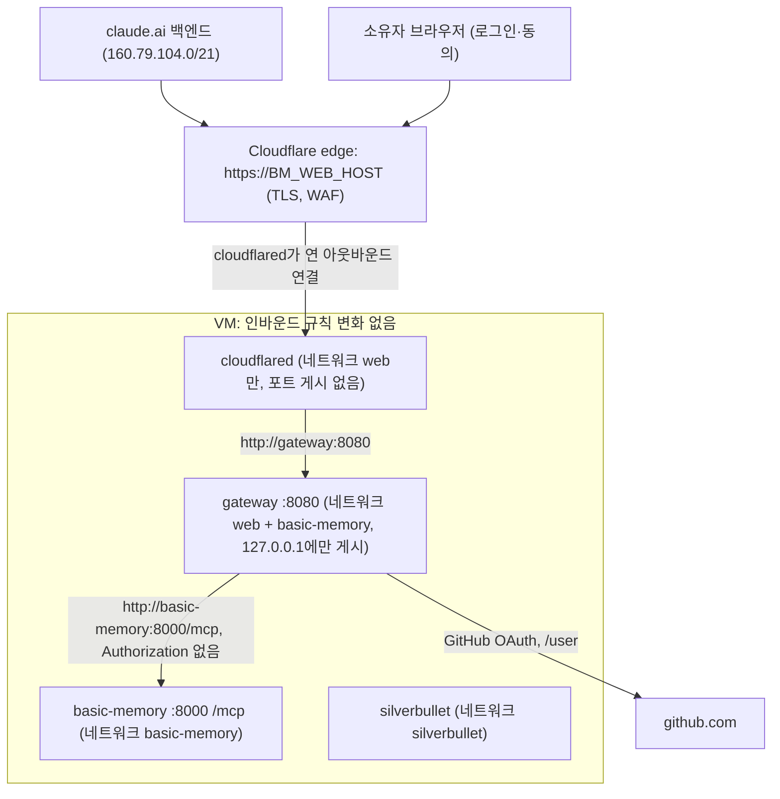

# claude.ai 웹 커넥터 (OAuth 게이트웨이 + 아웃바운드 터널) — 설계

- 구현 계획: `docs/plans/`의 계획 25 하나에 배포까지 담는다(18~23은 개선 백로그, 24는 에이전트 기억 미러가 쓴다). Task 1~3은 코드·테스트·문서이고 VM에서는 아무것도 실행하지 않는다(코드 PR). Task 4는 코드 PR이 병합된 뒤 사용자와 함께 VM에 켜고 claude.ai에서 확인한다(결과 PR).
- 대체 범위: [GCP 설계](spec-2026-10-12-basic-memory-gcp-tailscale.md) 완료 조건 2(`:38-41`)의 "공개 노출이 없다"와 [접속 방식 설계](spec-2026-10-15-access-modes.md) §9의 "공인 인터넷 인그레스 0"(`:278`)을 §3.6의 규칙으로 바꾼다. 접속 방식(`BM_ACCESS`) 자체는 바꾸지 않는다. 결정은 [ADR 0008](../decisions/adr-2026-10-22-0008-web-connector.md)에 남긴다.
- 출처: [2026-10-16 조사](../research/rsch-2026-10-22-web-connector-exposure.md)(4개 주제, 공식 문서 기준), 2026-10-22 시제품 측정(FastMCP 4.1.3, VM의 Basic Memory 0.23.2), 같은 날 사용자 결정.

## 1. 목적과 범위

Basic Memory를 claude.ai(웹, 그리고 같은 계정의 Desktop·모바일 커넥터)에서 쓰게 한다. claude.ai는 사용자 기기가 아니라 Anthropic 클라우드에서 MCP 서버를 호출하므로 tailnet이나 `make tunnel`의 `127.0.0.1`로는 닿지 않는다(§2). 그래서 VM에 선택 기능 `BM_WEB`을 더한다. 켜면 `cloudflared`가 Cloudflare로 나가는 연결을 열고, 공개 호스트명은 그 연결을 거쳐 OAuth 게이트웨이에만 닿는다. 게이트웨이는 GitHub 로그인 한 명만 통과시킨다.

**사용자 결정 (2026-10-22)**
1. "VM에 공개 인그레스 0" 불변식을 "인바운드 방화벽 개방 0 + OAuth로 잠긴 공개 경로 1개"로 바꾼다(대안: 불변식 유지와 Basic Memory Cloud, 웹 사용 포기).
2. 로그인이 강제되면 웹에서도 노트 전체가 보여도 된다(대안: 웹 전용 프로젝트, 두 번째 인스턴스).
3. 쓰기 도구도 연다(대안: 읽기 전용, 추가만). 프로젝트 단위 도구 `create_memory_project`·`delete_project`는 웹에서 막는다(추천안을 "계속하세요"로 승인).
4. 사용자의 ChatGPT는 Plus($20)다. 이번 범위는 Claude만이다(추천안 승인).
5. 노출 경로는 Cloudflare named Tunnel, 인증 계층은 FastMCP 게이트웨이, 로그인은 GitHub다(2026-10-16 조사의 권장 구성을 결정 1과 함께 승인).
6. claude.ai Research 모드는 승인 없이 도구를 부르므로 `delete_note`도 웹에서 막는다(대안: 런북 안내와 백업만, 그대로 수용). 웹에서는 쓰기·수정·이동까지 하고, 삭제는 Claude Code나 SilverBullet으로 한다.

**범위 밖**
- ChatGPT. OpenAI 도움말은 쓰기 포함 MCP를 Business·Enterprise·Edu에만 열고 Pro는 read/fetch, Plus는 언급이 없다(§2). 게이트웨이 메타데이터에 `offline_access`도 없다. 필요해지면 별도 스펙으로 다룬다.
- Tailscale Funnel, VM 방화벽의 443 개방, GCP 부하 분산기·IAP for HTTPS. 금지는 그대로다(§3.1).
- Claude MCP tunnels(Enterprise 전용 research preview)와 OpenAI Secure MCP Tunnel.
- 자동 백업 일정. 지금처럼 `make backup`을 사람이 실행한다. 웹을 켜기 전 백업만 Task 4에 넣는다.
- 노트 범위 분리(결정 2).

**완료 조건**
1. `make check`가 통과하고, §5의 새 구조 테스트가 웹 경로의 불변식(포트 미게시, 네트워크 격리, 헤더 미전달, 도구 허용 목록, 의존성 해시)을 강제한다.
2. `BM_WEB`이 없거나 `off`면 모든 Make 타깃의 동작이 계획 25 직전과 같고, 기존 bats 테스트는 고치지 않고 통과한다. 웹 서비스는 로컬과 VM 어디에서도 뜨지 않는다.
3. `BM_WEB=on`에서 `make local-up local-verify`가 게이트웨이를 띄우고, 토큰 없는 요청의 `401`·`resource_metadata`, 보호 리소스 메타데이터, 인가 서버 메타데이터(S256, CIMD), 벤더가 아닌 redirect URI의 등록 거절을 확인한다. 게이트웨이 동작 테스트(§5.1)도 통과한다: 소유자가 아니면 도구 0개와 호출 거절, 막은 도구 세 개는 소유자에게도 없음, 백엔드가 `Authorization`을 받지 않음.
4. Task 4에서 VM에 켠 뒤 `make verify`가 공개 URL 검사(§5.2)를 통과하고, GCP 방화벽에서 VPC 밖 소스를 허용하는 규칙은 지금과 같다(`allow-iap-ssh` 하나).
5. claude.ai에 커넥터를 등록하고 소유자 GitHub 계정으로 연결한 뒤, 테스트 노트를 쓰고 읽고 수정한다. 도구 목록에 `delete_note`·`create_memory_project`·`delete_project`가 없다. 테스트 노트는 `make tunnel`을 거친 Claude Code로 지운다.
6. 켠 뒤 24시간 동안 OOM이 없고 기존 두 컨테이너가 healthy이며, `make status`의 메모리·스왑과 프록시 경유 도구 호출 지연을 계획 25 Progress log에 남긴다.

## 2. 근거가 된 사실 (2026-10-22, `main` 7a3748d)

claude.ai 커스텀 커넥터 (2026-10-16 조회):

- **Verified ([Claude Help 11175166](https://support.claude.com/en/articles/11175166-about-custom-connectors-using-remote-mcp)):** Free(1개)·Pro·Max·Team·Enterprise에서 추가할 수 있다. 원격 MCP 연결은 Anthropic 클라우드에서 나가고, 커넥터는 계정 단위라 web·Desktop·모바일에 함께 나타난다. 도구마다 승인 요구나 Blocked를 정할 수 있고, Research 모드는 추가 승인 없이 도구를 부른다.
- **Verified ([Claude troubleshooting](https://www.claude.com/docs/connectors/building/troubleshooting)):** 커넥터는 IPv4 전용이다. 사설 대역, CGNAT `100.64.0.0/10`(Tailscale), loopback으로 풀리는 호스트는 요청 전에 거절한다. WAF가 Anthropic 대역에 403/429를 내는 것과 프록시가 `WWW-Authenticate`를 바꾸는 것이 대표 실패 원인이다.
- **Verified ([Claude docs: Authentication](https://www.claude.com/docs/connectors/building/authentication)):** 인증은 없음 또는 OAuth(DCR·CIMD)다. 고정 헤더(`static_headers`)는 일부 조직 한정 beta다. PKCE S256, RFC 9728 메타데이터와 `401`의 `resource_metadata`가 필요하다. CIMD는 인가 서버가 `client_id_metadata_document_supported: true`와 `token_endpoint_auth_methods_supported`의 `none`을 광고할 때만 쓰고, 아니면 DCR로 넘어간다. 콜백은 `https://claude.ai/api/mcp/auth_callback`이다. 디스커버리·등록·토큰 엔드포인트는 10초, refresh는 30초 안에 응답해야 한다.
- **Verified ([Claude API IP addresses](https://platform.claude.com/docs/en/api/ip-addresses)):** 아웃바운드 대역은 `160.79.104.0/21`이다. 모든 Claude 사용자가 같은 대역을 쓰므로 IP 제한은 인증을 대신하지 못한다.

ChatGPT (2026-10-22 조회):

- **Verified ([OpenAI Help 12584461](https://help.openai.com/en/articles/12584461-creating-custom-mcp-apps-in-chatgpt), 2026-10-14 갱신):** "Full MCP is only available to Business and Enterprise/Edu users, currently. Pro users can connect custom MCP servers with read/fetch permissions." Plus는 적혀 있지 않다. OAuth에 `offline_access`가 없으면 만료 뒤 재인증이 필요할 수 있다.
- **Reported ([tech2](https://www.tech2.com/ai/new-affordable-chatgpt-pro-plan-introduced-heres-how-it-compares-to-go-and-plus-plans-and-which-is-the-right-plan-for-you-text-10026200.html)):** Plus는 월 $20, Pro는 2026-04부터 $100·$200이다.

Basic Memory와 FastMCP (2026-10-22, 이 Mac):

- **Verified (Command: `make tunnel` 상태에서 VM의 `tools/list`):** 도구는 21개이고 모두 `annotations`가 있으며 15개가 `readOnlyHint=true`다. 쓰기 도구는 `write_note`·`edit_note`·`move_note`·`delete_note`·`create_memory_project`·`delete_project`이고, 이 중 `write_note`·`edit_note`·`delete_note`·`delete_project`가 `destructiveHint=true`다. `serverInfo`는 `Basic Memory`, `4.0.0b1`이다.
- **Verified:** Basic Memory 0.23.2 이미지 안의 FastMCP는 `4.0.0b1`이고, 그 `ProxyClient`에는 `forward_incoming_headers` 인자가 없다. 이 이미지로 게이트웨이를 돌리면 클라이언트의 `Authorization` 헤더가 Basic Memory로 넘어가는지 통제할 수 없다.
- **Verified (FastMCP 4.1.3 소스):**
  - 프록시와 미들웨어: `create_proxy(target, auth=..., middleware=[...])`(`fastmcp/server/server.py:2528`), `ProxyClient(url, forward_incoming_headers=...)`(기본 `True`, `fastmcp/server/providers/proxy.py:1721`), `AuthMiddleware(auth=callable)`(`fastmcp/server/middleware/authorization.py:82`). `enable(names=..., only=True)`는 허용 목록 모드다(`fastmcp/server/providers/base.py:692-702`).
  - GitHub 로그인: `GitHubProvider(client_id, client_secret, base_url, jwt_signing_key, allowed_client_redirect_uris, client_storage, cache_ttl_seconds, enable_cimd=True, ...)`(`fastmcp/server/auth/providers/github.py:216-239`). 토큰을 검증할 때마다 GitHub `/user`를 불러 클레임을 채운다. `sub`는 바뀌지 않는 숫자 id(`str(user_data["id"])`, `github.py:168`), `login`은 사용자 이름이다(`:169`). `cache_ttl_seconds`의 기본값은 `None`이다.
  - 등록 저장소: 클라이언트 등록 저장소의 기본 위치는 `FASTMCP_HOME/oauth-proxy/<키 지문>`이다(`oauth_proxy/proxy.py:597-607`). 키가 바뀌면 새 지문 디렉터리를 만들고, 이전 디렉터리는 지우지 않는다(`proxy.py:603-605`). DCR은 끌 수 없고(`proxy.py:463`), 등록 레코드는 만료 없이 파일로 남는다(`proxy.py:1081-1084`). CIMD 경로도 redirect 허용 목록을 적용한다(`proxy.py:709-713`).
  - 만료 기록: 인증 없는 `/authorize`가 쓰는 인가 트랜잭션(15분, `proxy.py:1215`)처럼 TTL이 있는 기록도, 만료된 파일은 그 키를 다시 읽거나 `cull()`을 부를 때까지 디스크에 남는다(`key_value/aio/stores/filetree/store.py:440-443`). FastMCP 4.1.3은 `cull()`을 부르지 않는다(`fastmcp/` 전체 grep 결과 없음).
  - 시험용 토큰 검증기: `fastmcp/server/auth/providers/debug.py`가 있다.
- **Verified ([GitHub Docs: Username changes](https://docs.github.com/en/account-and-profile/concepts/username-changes), 2026-10-22):** "After changing your username, your old username becomes available for anyone else to claim."
- **Assumption:** GitHub 숫자 id는 사용자 이름을 바꿔도 그대로다. 위 문서에는 적혀 있지 않다.
- **Verified (시제품, 가짜 GitHub 자격 증명):**
  - 401: 토큰 없는 `POST /mcp`는 `401`과 `WWW-Authenticate: Bearer scope="user", resource_metadata=".../.well-known/oauth-protected-resource/mcp"`를 낸다.
  - 인가 서버 메타데이터: `code_challenge_methods_supported=['S256']`, `token_endpoint_auth_methods_supported=['none','private_key_jwt']`, `client_id_metadata_document_supported=true`, `authorization_response_iss_parameter_supported=true`, `scopes_supported=['user']`(`offline_access` 없음)다.
  - 등록: `allowed_client_redirect_uris`에 없는 redirect URI의 DCR은 `400 invalid_redirect_uri`이고, Claude 콜백은 등록된다. authorize는 동의 화면(`/consent`)으로 보낸다.
- **Verified (시제품):** 프록시를 거쳐도 도구 21개와 `readOnlyHint` 15개가 그대로 보인다. `recent_activity` 중앙값은 직접 319 ms, 프록시 경유 1703 ms였다. 이 Mac에서 VM까지 SSH 터널 왕복이 끼어 있고, `ProxyClient`는 요청마다 백엔드 세션을 새로 연다.
- **Verified (Linux arm64 컨테이너, `docker stats`):** 게이트웨이는 유휴 77 MiB, 읽기 호출 40번 뒤 78 MiB였다. `cloudflared` 2026.10.3은 quick tunnel(origin 없음)로 22~27 MiB였다.
- **Verified:** FastMCP 공식 컨테이너 이미지는 GHCR에 없다(`docker manifest inspect ghcr.io/prefecthq/fastmcp:4.1.3` 실패).

저장소와 VM:

- **Verified:** `tests/repo-config.bats:22`는 모든 서비스에 숫자 태그와 digest로 고정된 `image:`를 요구한다. `build:`만 있는 서비스는 실패한다. `:37`은 `ports:` 항목이 모두 `127.0.0.1:`로 시작하는지, `:46`은 `logging: *bounded-logging`을 검사한다. 서비스별 네트워크 검사는 `:84`(basic-memory)와 silverbullet 블록에만 있다.
- **Verified:** `make local-up`은 `up -d --wait`(`Makefile:62`), 배포는 `up -d --wait --wait-timeout 360`(`scripts/deploy-stack.sh:42`)이라 지금은 모든 서비스를 띄운다. compose에 `profiles:`는 없다.
- **Verified:** VM `.env`는 `vm_env`(`scripts/lib/vm.sh:155-161`)가 출력한 값을 ssh 표준입력으로 받아 권한 600으로 쓴다(`scripts/deploy-stack.sh:30-33`).
- **Verified:** `verify-vm.sh`는 공인 IP의 22·80·443·8443·8737·3000이 닫혔는지 본다(`:18`, `:209`). `verify-mcp.sh`의 `rpc`는 HTTP 200이 아니면 실패한다(`:81-98`).
- **Verified (`make status`, 2026-10-22):** memory used 41%(total − available 기준, `scripts/show-status.sh:11-15`), swap 511/1023 MB. [ADR 0002](../decisions/adr-2026-10-12-0002-vm-sizing.md)는 24시간 유휴 때 swap 508/1023을 기록했고, 스왑이 절반 이상 머물거나 OOM이 나면 다시 정한다고 적었다.
- **Assumption:** 게이트웨이와 `cloudflared`가 amd64 VM에서 쓰는 메모리는 arm64 측정과 비슷하다. Task 4에서 잰다.
- **Assumption:** VM 안에서는 게이트웨이와 Basic Memory가 같은 호스트라, 요청마다 세션을 새로 여는 비용이 수십 ms 수준이다. Task 4에서 잰다.
- **Assumption:** Cloudflare named Tunnel은 streamable HTTP 응답을 버퍼링하지 않는다. Anthropic 문서가 로컬 서버를 공개할 때 Cloudflare Tunnel을 예로 든다([Claude docs: testing](https://www.claude.com/docs/connectors/building/testing)). Task 4에서 확인한다.

## 3. 설계

### 3.1 노출 경로와 인증 계층

| 경로 | VM 인바운드 | 경로 자체의 인증 | 고른 이유 / 버린 이유 |
|---|---|---|---|
| **Cloudflare named Tunnel** | 변경 없음 | 없음(게이트웨이가 담당) | 고름. 표준 443, 아웃바운드만 필요, 비용은 도메인뿐 |
| Tailscale Funnel | 변경 없음 | 없음 | ssh 모드 VM은 Tailscale이 꺼져 있다. 한 VM 두 모드 금지와 Funnel 금지 검사 세 곳을 풀어야 한다 |
| 공인 IPv4 443 + Caddy | 443 개방 | 없음 | 방화벽을 연다. 인터넷 스캔을 1GB VM이 직접 받는다. 계획 07(IPv6)과 충돌한다 |
| GCP LB + IAP | LB | Google 신원 | 월 약 $18이다. 벤더 서버가 통과하지 못한다 |

| 인증 계층 | 고른 이유 / 버린 이유 |
|---|---|
| **FastMCP 게이트웨이** | 고름. CIMD·DCR·S256·RFC 9207을 광고하고(§2 Verified), 소유자 확인과 도구 허용 목록을 한 곳에서 강제한다 |
| Basic Memory 이미지로 게이트웨이 실행 | 새 이미지가 필요 없지만 FastMCP 4.0.0b1에 `forward_incoming_headers`가 없다(§2) |
| sigbit/mcp-auth-proxy | 사용자 제한은 내장이지만 DCR만 되고 도구 허용 목록이 없으며, 마지막 릴리스가 2026-05다 |
| Pomerium | 설정만으로 되지만 Envoy 기반이라 1GB VM에서 가장 무겁다(미측정) |
| Cloudflare Access Managed OAuth | VM 메모리를 거의 쓰지 않는다. 대신 origin이 Access JWT를 검증해야 하고(Basic Memory는 못 함) 도구 필터가 없다. §6의 대안으로 남긴다 |

### 3.2 구성

1. 사용자가 claude.ai에 `https://<BM_WEB_HOST>/mcp`를 커스텀 커넥터로 등록하면, Anthropic 백엔드가 Cloudflare edge로 요청을 보낸다.
2. edge가 TLS를 끝내고, VM의 `cloudflared`가 미리 열어 둔 연결로 요청을 넘긴다. 공개 호스트명의 서비스는 `http://gateway:8080` 하나다.
3. 게이트웨이는 토큰이 없으면 `401`과 `resource_metadata`로 답한다. Claude는 메타데이터를 읽고 CIMD로 등록한다. 조건이 맞지 않으면 DCR로 등록한다.
4. 소유자 브라우저가 게이트웨이의 동의 화면을 거쳐 GitHub에 로그인하면, 게이트웨이가 자기 JWT를 발급한다.
5. 이후 요청마다 게이트웨이가 토큰, GitHub 사용자 id, 도구 허용 목록을 검사한다. 통과하면 `Authorization`을 떼고 Basic Memory로 넘긴다.

`cloudflared`는 `web` 네트워크에만 있다. 그래서 Cloudflare 대시보드의 경로 설정이 틀려도 Basic Memory와 SilverBullet에 닿지 못한다. Basic Memory·SilverBullet의 네트워크와 `127.0.0.1` 게시는 바꾸지 않는다.

### 3.3 선택 기능 `BM_WEB`

- `.env`의 `BM_WEB`이 `on`일 때만 켠다. 비어 있거나 `off`면 꺼짐이다. 다른 값이면 원격 접속 전에 실패한다(`access_mode`와 같은 방식). `BM_ACCESS`와 독립이라 두 접속 방식 모두에서 쓸 수 있다.
- compose에서 `gateway`는 `profiles: [web]`, `cloudflared`는 `profiles: [tunnel]`에 둔다. 프로필은 `docker compose`의 `--profile` 인자가 아니라 `COMPOSE_PROFILES`로 켠다. VM에서는 `vm_env`가 VM `.env`에 `COMPOSE_PROFILES=web,tunnel`을 쓰고, 로컬에서는 Make가 `local-*` 타깃에 `COMPOSE_PROFILES=web`을 넘긴다. 그래서 로컬에서는 `cloudflared` 없이 게이트웨이만 뜬다.
  - **내 결정:** 기존 compose 명령 문자열을 그대로 둔다. `tests/repo-make.bats:69`가 `docker compose -f compose.yaml up -d --wait`를 정확히 검사하고, 개선 백로그의 계획 19도 `local-down`·`local-logs` 명령을 고정하려 한다. 복원(`scripts/restore-notes.sh`)도 같은 `.env`를 쓰므로, 복원하는 동안 게이트웨이도 함께 멈췄다가 뜬다.
- 웹 서비스의 환경변수는 `${VAR:-}`로 읽고 `${VAR:?}`를 쓰지 않는다. compose는 꺼진 프로필의 서비스까지 변수를 치환하므로, `:?`를 쓰면 `BM_WEB=off`인 설치에서도 모든 compose 명령이 실패한다. 값 확인은 배포 전의 스크립트와 게이트웨이 시작 시점에 한다.
  - **Verified (2026-10-22, Docker Compose v5.0.2, 임시 compose 파일로 `config --services`):** 프로젝트 디렉터리 `.env`의 `COMPOSE_PROFILES=web,tunnel`이 두 프로필을 켠다. 환경변수 `COMPOSE_PROFILES=web`은 `.env` 값보다 앞서 `web`만 켠다. 꺼진 프로필 서비스의 `${VAR:?}`도 값이 없으면 `required variable ... is missing a value`로 실패한다.
- `BM_WEB=on`이면 배포가 `gateway/`의 런타임 파일을 VM 앱 디렉터리(`/opt/basic-memory/gateway/`)에 올린다. 지금 배포는 `compose.yaml`과 `.env`만 올린다(`scripts/deploy-stack.sh:26-33`).
- `BM_WEB=off`로 배포하면 VM에 남아 있는 웹 서비스를 멈추고 지운다.
- 공개 호스트명과 그 호스트명이 풀리는 IP는 스크립트가 출력하지 않는다. 출력을 Progress log나 PR에 붙이면 저장소 공개 문서에 남기 때문이다(개선 백로그 계획 18의 공개 텍스트 검사는 호스트명을 잡지 못한다).
- `.env` 값(이름은 제안이고 계획에서 확정한다):

| 변수 | 비밀값 | 내용 |
|---|---|---|
| `BM_WEB` | 아니오 | `on` / `off` |
| `BM_WEB_HOST` | 아니오 | 공개 호스트명(예: `mcp.<domain>`). 저장소 문서에는 자리표시자만 쓴다 |
| `BM_WEB_PORT` | 아니오 | 게이트웨이의 `127.0.0.1` 게시 포트(기본 8738). 로컬 확인과 VM의 loopback 검사에 쓴다 |
| `BM_WEB_GITHUB_USER_ID` | 아니오 | 통과시킬 GitHub 사용자의 숫자 id 하나(`gh api users/<login> --jq .id`) |
| `BM_WEB_GITHUB_CLIENT_ID` | 아니오 | GitHub OAuth App의 client ID |
| `BM_WEB_GITHUB_CLIENT_SECRET` | 예 | GitHub OAuth App의 client secret |
| `BM_WEB_JWT_KEY` | 예 | 게이트웨이 JWT 서명과 저장소 암호화 키(`openssl rand -hex 32`) |
| `BM_WEB_TUNNEL_TOKEN` | 예 | Cloudflare remotely-managed tunnel 토큰 |

비밀값 세 개는 `SB_USER`와 같게 다룬다. main 체크아웃 `.env`와 VM `.env`(권한 600)에만 두고, `vm_env`가 ssh 표준입력으로 넘기며, 출력에는 `mask`만 쓴다.

### 3.4 게이트웨이

- **위치와 이미지:** 코드는 `gateway/`(`gateway.py`, 해시 고정 `requirements.txt`)에 둔다. 런타임 이미지는 digest로 고정한 공식 `python:<버전>-slim`이다. 컨테이너가 처음 시작할 때 `pip install --require-hashes`로 의존성을 영구 볼륨에 설치하고, 이후에는 재사용한다. 설치 방식의 세부는 구현자가 정한다.
  - **내 결정:** 의존성은 이름 있는 Docker 볼륨에 둔다. `/srv/basic-memory` 아래에 두면 `make backup`이 수십 MB를 매번 묶기 때문이다. 서버 프로세스는 uid 1000(`BM_CONTAINER_UID`)으로 돈다. 공개 경로를 받는 유일한 프로세스라서 root로 두지 않는다.
  - **내 결정:** 게이트웨이는 `127.0.0.1:${BM_WEB_PORT}`에만 게시한다. 게시하지 않으면 `make local-verify`가 Mac에서 게이트웨이에 닿지 못한다. VM에서는 기존 loopback 검사(`verify-vm.sh`)로 확인하고, 공인 IP에서 닫혔는지 보는 포트 목록에도 더한다.
  - **내 결정:** FastMCP 공식 이미지가 없다(§2). 직접 만든 이미지를 GHCR로 배포하면 CI 게시 절차가 생기고, "병합한 뒤에야 digest를 고정할 수 있는" 순서 문제도 생긴다. 해시 고정은 digest 고정과 같은 수준의 재현성을 준다.
- **구성:** 시제품(§2)의 API를 쓴다. `create_proxy(ProxyClient(BM_URL, forward_incoming_headers=False), auth=GitHubProvider(...), middleware=[AuthMiddleware(소유자 확인)])`.
- **소유자 확인:** 토큰의 `sub`(GitHub 숫자 id)가 `BM_WEB_GITHUB_USER_ID`와 같을 때만 도구를 보이고 실행한다. 다른 GitHub 사용자는 로그인을 마쳐도 도구가 0개이고, 호출은 거절된다. **내 결정:** 사용자 이름(`login`)은 바꾸면 남이 다시 가져갈 수 있어서 쓰지 않는다(§2).
- **도구 허용 목록:** `enable(names=..., only=True)`로 연다. 목록은 §2의 21개에서 `delete_note`·`create_memory_project`·`delete_project`를 뺀 18개다(사용자 결정 3, 6). Basic Memory를 올려 도구가 늘어도 자동으로 열리지 않는다.
- **콜백과 동의:** `allowed_client_redirect_uris`는 Claude 콜백 하나다. 동의 화면(`require_authorization_consent`)은 기본값(켜짐)으로 둔다.
- **검증 캐시:** `cache_ttl_seconds=300`. **내 결정:** 요청마다 GitHub API를 부르지 않게 한다. 대신 5분 안의 계정 변경은 늦게 반영된다.
- **저장소:** 클라이언트 등록·토큰 저장소(`FASTMCP_HOME`)는 VM의 `/srv/basic-memory/gateway/`에 둔다. 기존 `make backup`·`restore` 범위에 들어간다. 저장된 GitHub 토큰은 `BM_WEB_JWT_KEY`로 암호화된다. 저장소 경로가 키 지문별이라(§2) 키를 바꾸면 기존 등록·토큰을 더 이상 읽지 못하지만, 이전 지문 디렉터리는 디스크에 남는다.
- **저장소 누적:** 인증 없는 요청도 파일을 남긴다. DCR 등록은 만료가 없고, `/authorize`의 트랜잭션처럼 TTL이 있는 기록도 만료 파일이 지워지지 않는다(§2). **내 결정:**
  1. 게이트웨이가 `client_storage`를 직접 만든다. 경로와 Fernet 암호화는 FastMCP 기본값과 같게 두고, 기동할 때와 일정 주기마다 그 저장소의 `cull()`을 부른다. 주기는 구현자가 이름 붙인 상수로 정한다.
  2. Cloudflare 무료 rate limit 규칙 하나를 인증 없이 저장소에 쓰는 경로(`/register`, `/authorize`, `/consent`)에 건다. Claude는 연결할 때만 이 경로를 부르므로 Anthropic 대역에 429가 날 일은 드물다. **Assumption:** 무료 규칙 하나로 여러 경로를 묶을 수 있다. Task 4에서 확인하고, 안 되면 `/register`에만 건다.
  3. `make status`가 게이트웨이 저장소의 크기와 등록 수를 보인다. 저장량 상한(별도 볼륨, 쿼터)은 두지 않는다. rate limit이 증가 속도를 묶고, `make status`와 Exposure audit이 크기를 보기 때문이다.
  4. 비우기: 런북 절차로 게이트웨이를 멈추고, `oauth-proxy/` 아래의 지문 디렉터리를 모두 지운 뒤 다시 켠다. 그다음 claude.ai에서 커넥터를 다시 연결한다. VM 파일을 지우므로 사용자 OK를 받는다. `BM_WEB_JWT_KEY`를 바꿀 때도 같은 절차로 이전 디렉터리를 지운다.
- **감사 로그:** 도구 호출마다 시각, GitHub 사용자 id, 도구 이름, 노트 식별자(인자의 경로·제목), 백엔드 호출 소요 시간(ms)을 표준 출력에 한 줄로 남긴다. 컨테이너 로그는 기존 `x-logging` 설정으로 30MB까지 남는다. 노트 본문은 남기지 않는다.
- **헬스체크:** 인가 서버 메타데이터를 GET한다. Basic Memory가 재시작하는 동안에도 게이트웨이는 메타데이터에 응답해야 한다(10초 제한, §2).
- **지연:** 요청마다 백엔드 세션을 여는 비용은 Task 4에서 감사 로그의 소요 시간으로 잰다. claude.ai 쪽 왕복은 Cloudflare와 Anthropic 경로가 섞여 직접 호출과 비교할 수 없기 때문이다. **내 결정:** 읽기 도구의 소요 시간 중앙값이 500 ms를 넘으면, 후속 work 브랜치에서 연결을 재사용하는 클라이언트로 바꾼다. 결과 PR은 막지 않는다.

### 3.5 `cloudflared`

- 이미지는 `cloudflare/cloudflared:<버전>@sha256:...`로 고정한다. 태그 `2026.10.3`은 `tests/repo-config.bats:10`의 형식에 맞다.
- remotely-managed tunnel(`tunnel run`, 토큰은 환경변수)로 돌린다. 공개 호스트명과 서비스(`http://gateway:8080`)는 사용자가 Cloudflare 대시보드에 설정하고, 그 절차를 런북에 적는다. **내 결정:** 로컬 설정 파일 방식은 Mac에서 `cloudflared` 로그인과 자격 증명 파일이 더 필요하다. 대시보드 오설정은 네트워크 격리(§3.2)가 막는다.
- quick tunnel(`--url`, `trycloudflare.com`)은 쓰지 않는다. 인증 없는 공개 URL을 만들기 때문이다.

### 3.6 바뀌는 규칙과 문서

`AGENTS.md:13`의 첫 문장을 다음으로 바꾼다(영어, 사용자 승인 대상):

> Basic Memory has no auth: publish every port on `127.0.0.1` only, never enable Tailscale Funnel, and add no inbound firewall rule beyond the access mode's own (none for tailscale, the tunnel range to port 22 for ssh). The only public path is the optional web connector (`BM_WEB=on`): `cloudflared` dials out and reaches only the OAuth gateway, which admits one GitHub account (by numeric id) and lists only allowed tools.

`AGENTS.md:22`의 비밀값 문장에 세 비밀값을 더한다. 함께 고칠 문서는 다음과 같다.

- `docs/ARCHITECTURE.md`: 토폴로지(`:8-34`), 구성 요소(`:39-49`), 신뢰 경계(`:75-83`), 주요 흐름(`:94-95`).
- `README.md`: 개요(`:3`)와 사용법에 웹 커넥터 한 단락.
- 새 런북(`make new-doc TYPE=runbook SLUG=web-connector`):
  - 도메인, Cloudflare Tunnel, GitHub OAuth App 만들기
  - claude.ai 커넥터 등록과 도구별 권한
  - 비밀값 교체
  - 게이트웨이 저장소 비우기(§3.4)
  - 차단 절차(§4)
- `docs/runbooks/rbk-2026-10-12-operations.md`의 Exposure audit(`:117-135`): Cloudflare 공개 호스트명이 하나뿐인지, GitHub OAuth App의 콜백, claude.ai 커넥터 목록, 게이트웨이 저장소 크기와 등록 수를 점검 항목에 더한다.
- `.agents/skills/bm-upgrade/SKILL.md`: 업그레이드 뒤 `tools/list`와 게이트웨이 허용 목록을 비교하고, 게이트웨이를 거쳐 Basic Memory에 닿는지 확인하는 단계.
- [ADR 0008](../decisions/adr-2026-10-22-0008-web-connector.md)을 코드 PR에서 `accepted`로 바꾼다.

## 4. 보안

- **공개 노출:** VM 방화벽은 바뀌지 않는다. 공개되는 것은 Cloudflare의 호스트명 하나이고, 그 뒤에는 게이트웨이만 있다. 게이트웨이의 OAuth 엔드포인트(메타데이터, 등록, authorize, 동의, 콜백, token)는 인증 없이 열려 있는데, 표준상 그래야 한다.
- **인증:** 경계가 네트워크(tailnet, IAP)에서 신원(GitHub 소유자 한 명)과 도구 허용 목록으로 옮겨 간다. 둘 다 게이트웨이 한 프로세스가 강제한다. 그래서 §5의 구조 테스트와 `verify`의 공개 URL 검사로 설정이 바뀌지 않았는지 계속 본다.
- **등록:** DCR은 누구에게나 열려 있다. 하지만 redirect URI가 Claude 콜백으로 묶여 있어서, 등록한 클라이언트로 받은 code는 claude.ai로만 간다.
  - 비교 사례: `mcp-memory-service`의 GHSA-5p27-64mv-pr73(열린 DCR로 미인증 사용자가 쓰기 토큰을 받음)은 사용자 확인이 없어서 생겼다. 여기서는 GitHub 로그인과 사용자 id 확인이 그 자리를 막는다.
  - 인증 없는 요청이 디스크에 남기는 파일은 주기적 `cull()`, rate limit, `make status`의 저장소 크기, 비우기 절차로 다룬다(§3.4).
- **토큰 전달:** 게이트웨이는 클라이언트의 `Authorization`을 Basic Memory로 넘기지 않는다(`forward_incoming_headers=False`, 구조 테스트로 강제). GitHub 토큰은 게이트웨이 저장소에 암호화돼 있고, 클라이언트에는 게이트웨이 JWT만 간다.
- **중개자:** Cloudflare edge에서 TLS가 끝나므로 노트 내용은 Cloudflare를 평문으로 지나간다. 노트는 어차피 Anthropic 대화에도 들어간다. 사용자 결정 2가 이를 전제로 한다.
- **프롬프트 인젝션:** 웹에서 클립한 노트, 웹 페이지, 다른 커넥터의 내용이 모델에게 쓰기 도구를 시킬 수 있다. Research 모드에서는 승인도 없다(§2). 쓰기는 결정 3으로 열었으므로 다음으로 대응한다.
  - 게이트웨이에서 `delete_note`와 프로젝트 단위 도구를 막는다(결정 6). 남는 `edit_note`·`write_note`의 덮어쓰기와 `move_note`는 되돌릴 수 있는 범위로 본다.
  - 런북에서 claude.ai 쓰기 도구에 "Always allow"를 쓰지 말라고 안내한다.
  - Task 4 전에 `make backup`을 한다. 덮어쓴 노트는 `make restore`나 백업 파일로 되살린다.
- **비밀값:** 세 개가 늘어 다섯 개가 된다(§3.3). 출력, 명령 인자, 저장소에 쓰지 않는다. 노출이 의심되면 런북 절차로 교체한다. GitHub secret은 재발급하고, `BM_WEB_JWT_KEY`를 바꾸면 모든 등록·토큰이 무효가 되며(이전 저장소 디렉터리는 §3.4의 비우기 절차로 지운다), 터널 토큰은 재발급한다.
- **차단:** 세 겹이다.
  1. 네트워크: `BM_WEB=off`로 배포하면 두 서비스가 사라진다. 급하면 런북의 한 줄 명령으로 `cloudflared`를 멈춘다.
  2. 토큰: `BM_WEB_JWT_KEY`를 바꾸고 배포한다.
  3. 클라이언트: claude.ai에서 커넥터를 지우고, GitHub OAuth App을 지운다.

## 5. 테스트와 검증

### 5.1 bats (VM 없이)

- `tests/repo-config.bats`에 더할 구조 테스트:
  - `cloudflared`에 `ports:`가 없다. `gateway`의 게시는 기존 `:37` 검사(`127.0.0.1:`만)가 다룬다.
  - `cloudflared`의 네트워크는 정확히 `[web]`, `gateway`는 `[basic-memory, web]`이다. `basic-memory`·`silverbullet`은 `web`에 없다(기존 `:84`와 silverbullet 검사 유지).
  - `gateway`는 `profiles: [web]`, `cloudflared`는 `profiles: [tunnel]`이고, 둘 다 `restart: unless-stopped`이며 헬스체크가 있고 `${VAR:?`를 쓰지 않는다.
  - `cloudflared` 명령에 `--url`이 없다. `scripts/`와 `compose.yaml` 어디에도 `trycloudflare`가 없다.
  - `gateway/requirements.txt`의 모든 패키지 줄에 `--hash=sha256:`이 있다.
  - `gateway.py`에 `forward_incoming_headers=False`, 허용 목록 모드, 소유자 확인, 저장소 `cull()` 호출이 있고, 허용 목록에 `delete_note`·`create_memory_project`·`delete_project`가 없다.
- 기존 이미지 고정·로그 제한 테스트(`:22`, `:46`)는 새 서비스에도 그대로 적용된다.
- 게이트웨이 동작 테스트(`gateway/` 안의 Python 테스트): 시험용 토큰 검증기(§2)로 소유자와 다른 사용자의 토큰을 만들고, 백엔드는 받은 헤더를 기록하는 가짜 MCP 서버로 둔다. 확인할 것은 세 가지다.
  1. 다른 사용자는 도구 목록이 비고 호출이 거절된다.
  2. 소유자에게도 `delete_note`·`create_memory_project`·`delete_project`가 없고, 이름으로 직접 불러도 거절된다.
  3. 백엔드가 받은 요청에 `Authorization`이 없다.
  - **내 결정:** `make check`의 테스트 이미지에는 Python을 넣지 않는다. 이 테스트는 게이트웨이 런타임 컨테이너 안에서 `make local-verify`(`BM_WEB=on`)가 돌리고, 계획 25의 각 Task 검증에 포함한다. CI는 바꾸지 않는다.
- 다음은 기존 `lib-vm.bats`·`deploy-stack.bats` 방식의 스텁 테스트로 확인한다: `BM_WEB` 값 검사(잘못된 값이면 ssh·curl 전에 실패), `vm_env`의 새 변수(`on`이면 `COMPOSE_PROFILES=web,tunnel`), 배포의 처리(`on`이면 `gateway/` 파일을 올리고, `off`면 남은 웹 컨테이너를 지움). 비밀값이 출력에 없는지도 `deploy-stack.bats:10`처럼 검사한다.
- `BM_WEB`이 없을 때 기존 테스트가 고치지 않고 통과한다(완료 조건 2).

### 5.2 Make 타깃

- `make local-up local-verify`(`BM_WEB=on`, 가짜 GitHub 자격 증명 허용): 게이트웨이가 healthy인지 보고, §2의 시제품과 같은 네 가지를 확인한다.
  1. 토큰 없는 요청의 `401`과 `resource_metadata`
  2. 보호 리소스 메타데이터의 `resource`
  3. 인가 서버 메타데이터의 S256·CIMD·`none`
  4. 벤더가 아닌 redirect URI의 등록 거절
- `make verify`·`make probe`(`BM_WEB=on`): 기존 검사에 더해 Mac에서 `https://<BM_WEB_HOST>`로 같은 네 가지를 확인하고, 호스트명이 공개 IPv4로 풀리는지 본다.
  - 비밀값이 필요 없으므로 `probe`에서도 돈다.
  - 등록 거절 검사는 아무것도 저장하지 않는다. 유효한 클라이언트는 등록하지 않는다.
  - 호스트명과 해석된 IP는 출력하지 않고 "공개 IPv4로 풀린다"만 알린다(§3.3).
  - 게이트웨이 포트(`BM_WEB_PORT`)가 `127.0.0.1`에만 열려 있는지와 공인 IP에서 닫혀 있는지도 본다.
- `make status`(`BM_WEB=on`): 두 웹 컨테이너의 상태와 게이트웨이 저장소의 크기·등록 수를 함께 보인다.
- **Assumption:** 실제 GitHub 로그인과 claude.ai 연결은 자동화하지 않는다. Task 4에서 사람이 확인한다.

## 6. 위험과 대응

| 위험 | 대응 |
|---|---|
| 1GB VM 메모리 부족(스왑이 이미 절반, ADR 0002의 재결정 기준) | Task 4에서 24시간 관찰한다(완료 조건 6). OOM이나 스왑 포화가 오면 `BM_WEB=off`로 끄고, VM 메모리를 쓰지 않는 Cloudflare 쪽 인증(Access Managed OAuth 또는 Worker)으로 다시 설계한다 |
| 게이트웨이 설정 실수로 인한 우회 | §5.1 구조 테스트, `verify`의 공개 URL 검사, Exposure audit 항목 추가 |
| 프롬프트 인젝션으로 노트 변경(Research 모드는 승인 없음) | `delete_note`와 프로젝트 단위 도구 차단, 클라이언트 승인 안내, 웹을 켜기 전 백업. 되돌리기는 `make restore` |
| Basic Memory 업그레이드가 도구를 바꾸거나 Host 검사를 켬(업스트림 PR #1697, 미릴리스) | 허용 목록이라 새 도구는 열리지 않는다. `bm-upgrade`에 허용 목록 비교와 게이트웨이 경유 확인 단계를 넣는다 |
| 첫 기동 때 PyPI에 닿지 못함 | 기존 Basic Memory·SilverBullet에는 영향이 없다. 볼륨에 설치된 뒤에는 재사용한다 |
| Cloudflare WAF·봇 차단이 Anthropic 대역을 막음 | 런북에 Bot Fight Mode 확인과 `160.79.104.0/21` 예외를 적고, Task 4에서 확인한다 |
| 계획 07(IPv6 전용)에서 `cloudflared`가 동작하지 않음 | 계획 07의 확인 항목으로 넘긴다. claude.ai 쪽은 Cloudflare edge가 IPv4를 받으므로 VM이 IPv6 전용이어도 된다(Assumption) |
| 프록시 경유 지연 | §3.4의 500 ms 기준으로 Task 4에서 잰다 |

## 7. 계획 분할

| 계획 | 범위 | 시작 조건 |
|---|---|---|
| 25 web-connector | Task 1: 게이트웨이(`gateway/`)와 compose 서비스, 구조 테스트, 로컬 확인. Task 2: `BM_WEB` 설정과 배포·`status`·`verify`. Task 3: 규칙과 문서(AGENTS.md, ARCHITECTURE, README, 새 런북, Exposure audit, `bm-upgrade`, ADR 0008 accepted). Task 4: VM 적용과 claude.ai 확인(사용자와 함께, 단계마다 OK, 결과 PR) | 이 스펙의 승인. Task 4는 코드 PR 병합과 §8의 사용자 준비물 |

다른 작업과의 순서(2026-10-22, 개선 백로그의 계획 18~23과 에이전트 기억 미러의 계획 24 기준):

- 계획 18·22·23·24와는 나란히 진행한다. 겹치는 곳은 `Makefile`, `AGENTS.md`, `tests/repo-make.bats`의 몇 줄이다. 나중에 병합하는 쪽이 `git merge origin/main`으로 맞춘다.
- 계획 19의 Task 4와 계획 20은 이 계획의 코드 PR이 병합된 뒤에 쓴다. 두 계획은 `AGENTS.md:13` 불변식과 신뢰 경계를 다시 적는데, 이 계획이 그 문장을 바꾸기 때문이다.
- VM을 바꾸는 Task는 한 번에 하나만 한다. 계획 21의 Task 4(VM 복구 훈련)와 이 계획의 Task 4가 겹치지 않게 한다.
- ADR 번호 0008은 이 스펙이 먼저 쓴다. 계획 18·19·20도 실행 중에 ADR을 만들므로, 병합 때 번호가 겹치면 나중 쪽이 `git mv`로 바꾼다.

## 8. Open questions

1. 공개 호스트명에 쓸 도메인. 이미 가진 도메인이 있으면 DNS를 Cloudflare로 옮기고, 없으면 새로 산다(.com 연 약 $10~11, 제3자 가격이라 **Reported**). Task 4의 시작 조건이다.
2. GitHub OAuth App을 만들 계정과 통과시킬 사람 계정 하나(숫자 id). Task 4의 시작 조건이다.
